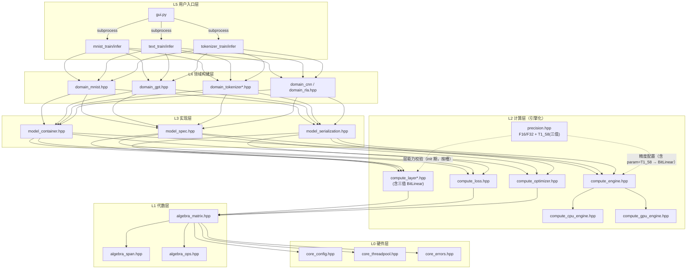

# AGENTS.md — AI 开发速览（neuralnet.cpp）

> 本文档专为 AI 编码助手编写：用最少 token 建立项目心智模型，快速开始开发。
> 人类向的完整文档在 `docs/`（索引见 §11）。**改代码前必读 §5 铁律与 §10 高频坑。**
> 本文只记录**当前状态**；演进记录、已修复勘误、被否决方案与性能 A/B 过程统一归档在 `docs/history/history.md`（索引见 §11）。当前能力清单见 §12。

## 1. 项目一句话

从零实现的 C++26 神经网络库：CPU / Vulkan 双后端，支持 MLP / ViT / GPT 训练推理 + BPE 分词器，可选 f16 混合精度。
`include/neuralnet.cpp/` 是 header-only 库（**统一聚合入口 `nn.hpp`**；也可按需 include `engine/layer/loss/optimizer/model/train.hpp` 薄转发头），`src/` 是可执行入口，`shaders/` 是 GPU 原语 shader。

## 2. 构建与测试

```bash
# 构建（默认 Release：-O3 -funroll-loops -march=native，Clang/GCC 另加 -fno-exceptions -Wall -Wextra -Wpedantic -Werror）
cmake -B build -G Ninja && cmake --build build

# 测试（默认关闭；开启后测试程序在 build/test/，并注册 ctest）
cmake -B build -G Ninja -DNN_ENABLE_TESTS=ON && cmake --build build && ctest --test-dir build
```

- 链接报 `permission denied`（`build/` 下 exe 正在运行被占用 → 构建中止，易误判为"未改动"）：追加 `-- -k 0` 让 ninja 跳过失败目标继续构建其余目标；被占用目标仍需关掉进程后重链。
- 编译器与标准库：**CMakeLists 不指定**（编译器由 CMake 默认探测或调用方 `CXX=...` / `-DCMAKE_CXX_COMPILER` 决定，标准库跟随编译器默认）；**CI 主矩阵显式指定 clang++**（Linux/Windows，避免 GCC 独有警告在 `-Werror` 下失败），另有一个 **MSVC Debug 冒烟 job**（`msvc-debug`：Windows + Visual Studio 18 2026 生成器 = cl.exe、`NN_ENABLE_GPU=OFF` 纯 CPU、Debug + ctest（除已知 C11 外全跑）；P1-5，2026-10-18 起）。标准库编译/链接两侧必须一致（否则链接期大量 `std::__cxx11::*` 未定义）。CMake 3.30+；已验证四组「编译器 × 标准库」**各自全新构建 + ctest**：clang 24 + libc++（本机 Linux）、g++ 15.2 + libstdc++（WSL，CPU-only）、clang 23 + MSVC STL 与 MSVC cl 19.51 + MSVC STL（Windows/102）——**MSVC 侧必须带 `/Zc:preprocessor`**（已写进 `CMakeLists.txt` 的目录级与接口选项）：cl.exe **默认的传统预处理器**把 `__VA_ARGS__` 代入嵌套宏时按"单个实参"处理，`NN_UNWRAP(x, msg)` 会静默退化成逗号表达式（条件恒真、检查永不触发），`NN_EXIT(x, code, msg)` 则直接 `C3861`；打开该开关后两者都按标准展开（详见 `docs/history/history.md` 的构建系统条目）。**MSVC Debug 另有两条实测必需的开关**：`/bigobj`（`text_train.cpp` 触发 C1128）与 `/STACK:8388608`（9 个测试默认 1 MB 栈触发 `0xC00000FD`），均已写进 `CMakeLists.txt`；**v1.10.0 发布复验（2026-10-21，本机 VS 2026 / cl 19.51 Debug CPU-only）实测 57 注册 / 37 pass + 20 skip / 0 failed，CI 口径（`-E "^rapt_test_f16$"`）56 注册 / 36 pass + 20 skip / 0 failed**（20 skip = 17 GPU 依赖 + 1 Vulkan 探针 + 2 个 app 发现类用例：`cli_precision_warning_test` / `chat_prompt_test` 在 VS 多配置下 exe 位于 `<build>/Debug/` 找不到 ⇒ 77 skip，所以这 2 个在 MSVC Debug 下实际不执行；旧记的 CI 51/51、完整 52/52 已随新增用例过时）。
- **Windows clang++ 栈口径**：GNU-like 驱动的 clang++ 在 Windows 上**不是** CMake 的 `MSVC` 分支，但链接仍走 `link.exe`、默认栈同样 1 MB；`CMakeLists.txt` 另加 `-Wl,/STACK:8388608`（102 实测 `t1_58_test` / `bitnet_struct_test` / `model_roles_test` 否则 SegFault）。
- **clang + libc++ 的口径差异**：`-Werror` 下 libc++ 会对"记录类型但从未使用"的局部变量报 `-Wunused-variable`（同一代码在 libstdc++ 下不报）——clean 构建四种组合时会先撞到，属**真实死变量**，删掉即可（先例：`src/kvrec_test.cpp` 的 `std::string ls;`）。
- 构建选项：`NN_ENABLE_NATIVE`（默认 ON，开启 `-march=native`，分发/CI 用 `OFF` 生成可移植基线）；`NN_ENABLE_TESTS`（默认 OFF）；`NN_ENABLE_PCH`（默认 ON，见下）；`NN_ENABLE_PROBES`（默认 OFF，见下条）。
- **预设构建（`CMakePresets.json`，2026-10-11 落地）**：`cmake --preset <名>` + `cmake --build --preset <名>` + `ctest --preset <名>`；`cmake --list-presets` 看全部。六个 preset = `release`（Release+native，无测试）/ `dev`（+`NN_ENABLE_TESTS`）/ `debug`（`-O0 -g`）/ `portable`（`NN_ENABLE_NATIVE=OFF`，发布/CI 口径）/ `cpu`（`NN_ENABLE_GPU=OFF`，纯 CPU 最短路径）/ `probes`（+`NN_ENABLE_PROBES`）。`binaryDir` = `build/<preset名>`；另有 `caller` 无关的 `build`/`test`/`workflow` preset（`cmake --workflow --preset dev` 一条命令走完）。**preset 只描述本仓的构建口径，不改变 CMakeLists 的默认值**——不带 preset 的 `cmake -B build -G Ninja` 行为与以前逐字相同。
- **探针统一编译门 `NN_ENABLE_PROBES`（默认 OFF，2026-10-10）**：凡"在**热路径**采样/打印/下载/扫描"的诊断代码一律走这个门——库内 `nn_dbg_scan`（`NN_F16_DEBUG` 逐中间量扫描）、`NN_PREC_TRACE`（变体分派与边界 cast 形状归因 `note_temp_`）、`nn::dsl::env_flag` / `ComputeEngine::prec_env_flag`（门关时**不求值 getenv**、恒 false）、`text_train` 的 `NN_NAN_TRACE` / `NN_MEM_STATS`，以及探针可执行目标 `mem_probe` / `f16_cpu_probe` / `gpu_stability_probe`（门关时**连目标都不创建**）。门经 `nn_core` 的 **INTERFACE** 定义传播（`NN_ENABLE_PROBES=1`）→ 所有 TU 与嵌入消费方取值一致（同头两种语义 = ODR 隐患）；`core_config.hpp` 把它折成 `NN_PROBES_ENABLED`（0/1）。**默认构建里探针不参与编译**：没有额外分支、没有字符串、没有 host 下载路径，相关环境变量一律无效——探针只在排障时 `-DNN_ENABLE_PROBES=ON` 重新配置，不允许"设了环境变量就悄悄拖慢正常训练/推理"。**例外（不进本门）**：① 初始化期读一次并缓存的**行为开关**——`NN_VULKAN_DEVICE` / `NN_VULKAN_NO_16BIT_ALU` / `NN_VULKAN_NO_TIMELINE`（设备与特性逃生阀）、`NN_POOL_BLOCK_MB` / `NN_POOL_LADDER_MAX_MB` / `NN_NO_EARLY_REAP` / `NN_CPU_PAUSE` / `NN_GPU_PROFILE`（池/调度 A/B），新增同类开关必须"读一次 + 缓存"；② `f16_writeback_probe` 是**注册在 ctest 的回归用例**（断言 in-place f16 写回 + 8 步 Adam 参数必须移动），刻意保留在默认测试门禁里。凡是"覆盖率/归因"类验收（如 `NN_PREC_TRACE` 的 V1 覆盖实测）必须在探针构建下复现。
- **作为库被消费（嵌入 3rd_party / FetchContent）**：门面目标 `neuralnet::nn`——消费方 `add_subdirectory` 后 `target_link_libraries(app PRIVATE neuralnet::nn)` + `#include <neuralnet.cpp/nn.hpp>` 即可（C++26/线程/`NN_HAS_VULKAN`/SPIR-V 嵌入头目录/Vulkan 链接/shader 生成顺序全部经接口传递）。嵌入时 `NN_BUILD_APPS` 默认 OFF（不编本仓 app/工具；顶层工程默认 ON）；`NN_ENABLE_GPU=AUTO|ON|OFF` 一行控制 GPU（`OFF`=纯 CPU 最快路径，`ON`=缺 Vulkan/glslc 配置期失败）；自研 `dsl::compute` 的融合注册 `nn_enable_gpu_fusion(<target> MAIN <main源>)`（仅 GPU 启用时有定义；**函数体在调用方作用域求值**，库内路径经 `NN_LIB_SOURCE_DIR`/`NN_LIB_BINARY_DIR` CACHE 变量解析，函数内不可用 `CMAKE_SOURCE_DIR`）。样例 `examples/downstream/`（独立工程），指南 `docs/usage/05-consume-as-library.md`。⚠ 两条实测约束：① `Vulkan::Vulkan` 是 imported 目标**不可跨目录直接引用**（消费方直接链接报 target not found），一律经 `neuralnet::nn` 传递；② 库头文件需要 `-Wno-pass-failed`/`-fexperimental-library`（Clang）与 `/utf-8`（MSVC），已作为接口选项随门面传递——漏传时消费方开 `-Werror` 会挂在 `#pragma clang loop` 警告上。
- **编译提速（默认已开启，无需额外配置）**：本工程 header-only，单 TU 17.5s 的大头是重复 parse `nn.hpp`（含 44 份原语 SPIR-V 嵌入头 + AOT 融合注册表）。已落地五件事：① `NN_ENABLE_PCH`——`nn.hpp` 预编译一次，由编译条件相同的目标 `REUSE_FROM nn_pch` 共享（本机 GPU+tests 构建实测 48 个候选目标、其中 2 个自带 PCH）；② `CMAKE_CXX_SCAN_FOR_MODULES OFF`——本项目零 C++ 模块，省掉每 TU 一次 `clang-scan-deps`；③ `scan_exprs` 的 glslc **并行**（`NN_SCAN_JOBS=<n>` 覆盖，`=1` 回串行）+ `fused_registry.hpp` **内容稳定写入**（内容不变则不动 mtime，靠自定义命令的 `restat` 掐断下游全量重编）；④ 编译器缓存探测扩到 ccache/**sccache**（`-DNN_COMPILER_LAUNCHER=<path>` 可指定）；⑤ **ccache × 共享 PCH 的兼容**（2026-10-11）——ccache 手册要求 Clang 侧 `sloppiness=pch_defines,time_macros` + `-include-pch` + **`-fno-pch-timestamp`** 三项齐备才肯缓存"用了 PCH 的 TU"；前两项由构建系统用 `cmake -E env` 钉进 `RULE_LAUNCH_COMPILE` 前缀（**不依赖用户全局 ccache 配置**），第三项（cc1 开关，必须 `-Xclang` 形式）自动加到 PCH 生成方与全部使用方。**修复前每一个用 PCH 的 TU 都记 "Could not use precompiled header" → 42+ 个目标的编译全部不可缓存**（缓存形同虚设却看不出来）；修复后同一个 TU：30.2s → **0.11s**（Release，命中缓存）。顺带删掉 `RULE_LAUNCH_LINK`（本项目不做 LTO，ccache 包链接只有开销）。实测（Debug/本机）：全量净构建 125.5s→72.7s、改单个源文件 43.9s→10.4s；Release+tests+GPU 全量冷构建 13m26s / 8 核（单个 TU ≈30s、PCH ≈54s；`-ftime-trace` 归因：**后端 29.1s vs 前端 4.0s** —— PCH 之后的大头已是 LLVM 优化/代码生成，不是头解析；口径与复现见 `docs/development/cmake-integration.md` §8）。**⚠ 两条不变量**：(a) 收集器目标（`scan_exprs`、`*_nnfusion_collect`）**不套 PCH**——前者在源文件内、include 之前 `#define NN_EXPR_SCAN`，PCH 会先于该宏展开 `nn.hpp` → DSL 收集钩子失效（注册表空）；(b) 新写"生成物参与 PCH"的场景必须显式 `add_dependencies(<pch_target>, <生成边>)`——`__has_include` 在 PCH 里**一次性**求值，早于生成完成就整块落空且因无 depfile 记录而永不重试。
- Vulkan 可选：CMake 自动探测 Vulkan + glslc，找到则定义 `NN_HAS_VULKAN` 启用 GPU，否则纯 CPU。支持多 Vulkan 设备选择（`--gpu` 参数，见 `cli/cli_gpu_option.hpp`）。
- **本机 GPU 测试（NVIDIA GeForce GTX 850M，Maxwell / 驱动 580.178.04 / Vulkan）**：① 设备节点 `/dev/nvidia*` 在受限沙箱内**不可见** → GPU 测试必须在非沙箱（提权）环境执行，否则只会落到 llvmpipe（软件光栅，慢且 f16 行为不同）；② 显式选卡 `NN_VULKAN_DEVICE=850M`（等价 CLI `--gpu=850M`），不写也会被自动选中（打分：独显 3 > 核显 2 > llvmpipe 1），显式写只是免歧义；③ Maxwell 无 `shaderFloat16`（f16 存储可用、f16 ALU 走回退）→ **f16 分派变体（V1/V2）的权威覆盖仍以 40HX（`ethan@192.168.1.102`）为准**，850M 适合跑"接线/闭合世界/三值正确性"这类冒烟与回归。
- **本项目不支持 CUDA**：后端仅 CPU / Vulkan，CLI 无 `--cuda` 参数；文档勿声称支持 CUDA。
- 应用入口：`build/{mnist_train,mnist_infer,text_train,text_infer,tokenizer_train,tokenizer_infer,dataset_gen,dataset_convert}`，另有 `layer_bench`（性能）与测试类可执行文件。`gui.py` 是 Python GUI，`train_pkg.py` 打包 `.nnpkg` 训练包，`cli_controllers.py` 提供 CLI 控制逻辑。

## 3. 目录速查（改什么任务 → 看什么文件）

| 任务 | 文件 |
|------|------|
| 加/改神经网络层（Linear/Attention/Norm/激活…） | `compute_layer.hpp`（聚合头）+ `compute_layer_{base,mlp,bitlinear,conv,softmax,attention,feedforward,transformer,gpt,rapt}.hpp`（`bitlinear` = 三值权重 BitLinear） |
| 加/改位置编码（Learned/Sinusoidal/RoPE/ALiBi/无） | `compute_position_encoding.hpp`（`PositionEncoder` 基类 + 子类 + 按注入点分开的两个工厂）+ `compute_layer_attention.hpp` 的 `AttnScoreMask` 族（掩码语义） |
| 加/改损失函数 | `compute_loss.hpp` |
| 加/改优化器（SGD/Adam/AdamW/**AdamWQuant**/Muon） | `compute_optimizer.hpp`（`AdamWQuant` = 量化状态 AdamW：状态 f16 + 按行有界尺度，4 B/权重 vs 8 B）。**名单唯一真源 = 该文件的 `kOptimizerTable`**（RV-04，2026-10-11）：CLI 帮助/校验（`nn::find_optimizer` / `nn::optimizer_names`）、`scan_exprs` dry-run、`mem_probe` 状态账、GUI 下拉（运行时从 CLI `--help` 派生 + `bench/gui_cli_audit.py` 第 [4] 节断言）全部查表——**新增优化器只需表 1 行 + `create_optimizer` 1 个分支**） |
| 加/改引擎原语（CPU 实现） | `compute_engine.hpp`（接口）+ `compute_cpu_engine.hpp` |
| 加/改引擎原语（GPU 实现） | `compute_gpu_engine.hpp` + `backend/compute_vk_backend.hpp` + `backend/compute_vk_device.hpp` + `shaders/*.comp`。`GpuBackend` 成员体已按主题拆成 4 个**片段**（`backend/compute_vk_backend_{destroy,frame,pipelines,ops}.inc`，由主文件在 class 体内按序 `#include`；纯移动，**片段不可单独编译**，改动按其主题选文件）；原语 SPIR-V getter 由 `NN_SPV_GETTER_LIST` 单一注册表展开（**新增 shader = 文件头加探测块 + 列表加 token**，见 RV-08） |
| 状态扫描原语（RLA/RAPT 的 `scan_prefix_outer`） | `shaders/scan_prefix_outer.comp`（**行归属 + 4 路展开**，专用路径 dk ≤ 64）+ 同一份源码以 `-DNN_SCAN_DK_MAX=32` 编出的**窄共享变体**（每 SM 驻留 6 个 WG 而不是 1 个；C++ 按 `dk ≤ 32` 选、缺则回落宽变体）。`scan_suffix_outer` **刻意保持原结构**（它是 D 的 `dk²×seq` 列式散布读主导的流量/争用受限 kernel，加占用率反而更慢） |
| 算子级配对 A/B（`layer_bench`） | `src/layer_bench.cpp`：`--op matmul,matmul_q,matmul_q_bw,scan_prefix,scan_suffix…`（`--f16` 走 f16 变体）+ `--dk <n>`（扫描原语 head 维）+ `--hash`（计时**之后**打印输出张量的位级 FNV-1a 64 —— 逐位不变的 kernel 改写必须哈希相同；放计时前会污染 ms） |
| 张量/设备抽象 | `compute_tensor.hpp` |
| 按需 include（不走聚合头） | `engine.hpp` / `layer.hpp` / `loss.hpp` / `optimizer.hpp` / `model.hpp` / `train.hpp` = **薄转发头**（`nn.hpp` 仍是唯一聚合头；只求好记，不省 parse） |
| 混合精度 / f16 类型系统 / 三值（T1_58） | `precision.hpp`（Precision 枚举含 `T1_58`、`precision_rank()`、`nn::f16`、`PrecisionProfile`）；层能力声明 `PrecisionSet`/`PrecisionSupport` + `Layer::precision_support()`/`layer_name()`（`compute_layer_base.hpp`）；三值打包布局 `ternary_pack.hpp`；打包 GEMM 原语 `trit_pack`/`matmul_q`(`_t`)（`compute_engine.hpp` + CPU/GPU 实现 + `shaders/{trit_pack,matmul_q,matmul_q_gemv}.comp`） |
| 矩阵/代数层（CPU 存储与手写内核） | `algebra_matrix.hpp` / `algebra_span.hpp` / `algebra_ops.hpp`（`Expression`/`BoolExpression` 概念在 `expr_dsl.hpp`） |
| 表达式 DSL / 融合 IR | `expr_dsl.hpp` / `expr_spec.hpp` / `expr_opt.hpp` / `expr_registry.hpp` / `expr_graph.hpp`（IR-C 图融合 = **现行能力**：`expr_graph.hpp` + `begin_expr/end_expr` + `dsl::start_expr/end_expr` + GPU 图执行；P1 链/P2 写穿多输出，已接入 Adam/AdamW step） |
| 后端代码生成（IR-D emitter 抽象） | `expr_emitter.hpp`（注册表）+ `expr_glsl_gen.hpp`（GlslEmitter） |
| 模型容器/规格/序列化 | `model_container.hpp` / `model_spec.hpp` / `model_serialization.hpp` / `model_keyvalue_record.hpp` |
| 训练生命周期容器（推荐入口） | `training_session.hpp`：`TrainingSession` 拥有 `Model` + `Optimizer` + `TrainingSessionState`（optimizer 先于 Model 析构），`train_step(micro_batch, options, step_fn)` 内置梯度累积并完成一次 update；不拥有数据/epoch/lr 曲线/断点策略（docs/todo/30） |
| 训练工厂（数据集 → global batch → 循环） | `text_trainer.hpp`：`nn::TextTrainer`（`create(session, dataset, TextTrainConfig)` → `fit()`；global→micro batch 切分、shuffle/lr 调度/非阻塞 loss 回读/测试评估/`TrainState` 与断点状态装配；Step 回调承载文本 sparse-CE）+ `text_train_config.hpp`（`nn::TextTrainConfig` = 训练配方唯一真源）+ `lr_scheduler.hpp`（update-step 级 lr） |
| MNIST / GPT / CNN / RLA / 分词器 模型工厂 | `domain_mnist.hpp` / `domain_gpt.hpp` / `domain_cnn.hpp` / `domain_rla.hpp` / `domain_tokenizer{,_base,_bpe,_charbpe}.hpp` |
| 训练/推理 CLI 入口 | `src/mnist_train.cpp` 等；公共 CLI 逻辑在 `include/neuralnet.cpp/cli/`（**`cli_help.hpp` = 各 `--help` 的统一排版器**：宽度感知对齐、统一版式；改帮助/加选项前先读其文件头的审计约定）。**`text_train` 已模块化（P1-1）且训练循环已上收库层（P2b）**：`cli/text_train_config.hpp`（`TrainConfig : nn::TextTrainConfig` + `--help` + argv 解析 = CLI 参数解析层，**唯一允许 `std::exit`**）、`cli/text_train_loop.hpp`（只装 CLI hooks：梯度日志/探针/`.nnckpt` 写盘 → 调 `TextTrainer::fit()`）、`cli/text_train_recovery.hpp`（`--resume`）、`cli/text_train_checkpoint.hpp`（`.nnckpt`/`.nnmodel` 产出 + 退出码语义）；`src/text_train.cpp` 只留接线与唯一出口 `main`，三个模块**不得终止进程**（经 `Result` 上抛；门禁 `bench/doc_inventory.ps1` 第 [6] 节） |
| 推理采样（top-k / top-p / 重复惩罚 / 种子）+ 多轮对话（`--turn`/`--reply-out`/`--system`） | 采样：`compute_layer_base.hpp`（`SamplingConfig` + 共用 `sample_next_token_`，**host 侧采样、不进 AOT 闭合世界**）+ `compute_layer_{gpt,rapt}.hpp` 的 `generate`（配置重载；旧 temperature 重载 = 全默认语义）+ `src/text_infer.cpp` 的 `--top-k`/`--top-p`/`--repeat-penalty`/`--repeat-window`/`--seed`。多轮：prompt 构建唯一真源 = `domain_tokenizer_base.hpp` 的 `Tokenizer::chat_prompt`（`ChatTurn` + 对话标记模板 + 按整轮截断到 `seq_len`）；CLI 侧 `--interactive`（进程内累积）与 `--turn`（历史由调用方自带，一次一问）+ `--reply-out`（回复落盘，GUI 取回复不解析日志）；GUI 侧 `cli_controllers.py` 的 `ChatSession` + `gui.py` 的「GPT 推理」页多轮面板；门禁 `chat_prompt_test` + `bench/gui_cli_audit.py` 第 [7] 节 |
| 统一数据集（`.nndataset`/`.nnvocab`/KVRecord v2） | `dataset.hpp`（`nn::Dataset` 只读类 + 生成期公共件；存储单位 = **doc**，`DatasetSubset{Train,Test}`）/ `dataset_samples.hpp`（训练单位 = **样本**：`TextSample`/`TextSampleSet`——切窗 + batch 装配；`steps_per_epoch(global_batch_size)` 是 optimizer update 数的派生量）/ `dataset_format.hpp`（文件标签/词表 blob/`.nnvocab` 编解码）/ `model_keyvalue_record.hpp`（KVRecord v1+v2）；生成/转换 CLI 在 `src/dataset_gen.cpp` / `src/dataset_convert.cpp`（设计与裁决见 `docs/todo/19-unified-dataset.md`） |
| 训练 step 剖析器（`NN_PROFILE=1` 门控） | `core_profile.hpp`（聚合器：帧栈 inclusive/exclusive 双口径、`stage::op` 聚合、`NN_PROFILE_TRACE` Chrome trace、`device_add` 设备侧回填（含 per-key 归因表）、`interned`/`interned_detail` 动态名驻留）；插桩点：`compute_engine.hpp` 42 个 NVI 入口 + `expr_dsl.hpp` 三入口（CPU 模板路径不经引擎，须单独计时）+ 两引擎 public-virtual override + `text_train` phase + Model/GPT/RAPT/Transformer 逐层逐块 scope + `compute_vk_backend.hpp` timestamp query（设备侧 kernel 表 / per-key 归因 / GPU busy%） |
| 构建期工具（AOT 融合） | `tools/scan_exprs.cpp`（**单步** = 收集 + 生成）/ `tools/fused_generate.hpp`（生成阶段，原独立工具 `gen_fused`；另有 `tools/decode_fused.py` 调试用）。**库外使用者**：CMake 函数 `nn_enable_gpu_fusion(<target> MAIN <含 main 的源>)`（定义在 `CMakeLists.txt`，样例 `examples/fusion_custom_layer*`） |
| 批量改写 / 一致性审计（改多处时用，均带 `-DryRun`） | `tools/edit_ranges.ps1`（行区间删除：四重断言 + **花括号平衡护栏**）/ `tools/test_refactor.ps1`（删定义块 / 插 include / 正则替换）/ `tools/apply_nn_try.ps1`（`auto X = f(); if (!X) …` → `NN_TRY`/`NN_TRY_CHECK`，L2 层，带 `-DryRun` 计数）/ `tools/doc_rename.ps1`（文档词法改名）/ `bench/doc_align_audit.ps1`（文档↔代码对齐审计：文件/符号/CLI/数字/测试名）/ `bench/doc_inventory.ps1`（引擎接口盘点 + **第 [4] 节 L2+ 分层审计：`Matrix`/Matrix 型 I/O 动词零命中门禁，铁律 #12** + **第 [5] 节手写 `return std::unexpected` 残留门禁，基线 0**） |
| 与 PyTorch 对拍 | `compare_with_torch/`（model.py / text_train.py / text_infer.py） |
| GUI ↔ CLI 一致性（改 `gui.py`/`cli_controllers.py`/任一 CLI 选项后跑） | `bench/gui_cli_audit.py`（**七节**：GUI→CLI flag 差集 + 反向缺失、幽灵选项=帮助声明 vs 解析分支、`gui.py` 的 `self.X` 赋值静态校验、优化器名单、**声明式字段表 ↔ Controller 闭包（P2-6）**、**断点续训禁列（P1-2）**、**多轮对话闭环（P0-5 尾项）**；退出码 0 = 无偏差。复现：`python bench/gui_cli_audit.py`） |
| 加/改 GUI 参数行（P2-6 声明式表） | `gui.py` 各 Tab 的 `fields()` —— **一个 `Field` = 一行 UI + 一条 `collect_args` 语义**（`Field`/`collect_fields`/`ParamsMixin` 在文件中部）；表表达不了的条件语义（engine→`--gpu`、精度预设→`--f16`/`--t1_58`、输入方式→`input`）留在该 Tab 的 `collect_args` 后处理里，并用 `_v()`/`ui_only=True` 声明给门禁 |
| 参与/贡献入口（**给非作者**：构建/测试/规范/PR/CI 口径） | `CONTRIBUTING.md` + `CODE_OF_CONDUCT.md`；预设构建 `CMakePresets.json`（`cmake --preset dev/portable/cpu/probes`） |
| 可引用的实测结论（结论/证据/重跑命令/边界） | `research/`（索引 `research/README.md`；一次研究一个子目录）。代码/设计稿引用这些结论时按四段式引用 |
| 代码风格（机器可读） | `.clang-format`（**目标风格**，用 `git clang-format` 只格式化自己的改动行；**不要**整仓重排）+ `.editorconfig` + `.gitattributes`（全仓 **LF**）；规则文本见 `docs/todo/10-development-standards.md` §8 |

## 4. 分层架构（L0→L5，严格单向依赖，上层只依赖下层公有接口）

### 4.1 架构概览图



### 4.2 核心设计原则

**引擎化（Engine-Based）**：Layer 的 `forward/backward` 只写一次，通过 `ComputeEngine&` 参数自动适配 CPU/GPU。

**算法与原语分离**：
- Engine 只提供 op-level 原语（`matmul`/`add`/`exp`/`reduce`…）
- Layer 用原语组合表达算法（`ReLU = max(x,0)`）
- Engine 不知道 "ReLU" 是什么

**数据流**：
```
Matrix → engine.from_matrix → Tensor[GPU] → forward/loss/optimizer 全程在 GPU → 仅 evaluate 时 to_matrix 回 CPU
```

**多精度**：`Precision`（F16/F32 为**存储/舍入**精度；BF16/F64 是保留值，使用即报错）贯穿张量存储与算子输出；`PrecisionProfile{param/compute/stable/optimizer}` 做模型级配置。语义锚点见 `precision.hpp` 头注释与 `docs/development/05-mixed-precision.md`。

**三值权重（T1_58，1.58-bit）**：`Precision::T1_58` 是**离散化**而不是舍入——它把权重按逐行 absmean 尺度投影到 `{-1,0,+1}`、需要额外尺度 γ，且**不进提升序**（`precision_rank()` 无定义，`max_precision` 对它 fail-fast）。P1 里它**不是存储精度**（`precision_bytes = 0`；`create_tensor`/`from_matrix`/`dsl::compute` 一律拒绝拿它建张量/当输出），只作为 `PrecisionProfile.param` 的一句声明 + 层能力集合的取值。落地形态：**每个 Layer 按槽声明自己支持的精度**（`PrecisionSupport{param,compute,stable,optimizer}`，默认 `{f16,f32}×四槽` → 既有层一行不改），`Layer::init`（NVI 首步）做唯一校验，不兼容组合 = **初始化期报错**（层名 + 槽位 + 取值 + 允许集合）；`set_precision_profile` 在已 init 时 fail-fast（"profile init 后不可变"）。谁声明什么：`BitLinear`（三值线性层：量化 forward + STE backward，latent 恒 f32）`param={T1_58}`、其余层默认。CLI 只有 `--precision-param t1_58`（**无别名**；compute/stable/optimizer 收它即解析期报错），`ModelSpec.weight_quant` 记住"该模型用 BitLinear"（缺键 = None → 旧文件零破坏）。**接线范围（P1 = MLP，P1.5 = GPT）**：GPT 的 4 个投影 / `fc1_/fc2_` / 未 tie 的 `lm_head_` 全部走 `make_linear_layer` 工厂（成员类型 `std::unique_ptr<Layer>`，与 `make_norm_layer` 同一先例），开关判据唯一 `effective_weight_quant()`（`precision.param == T1_58` ⇔ `weight_quant == T1_58`），profile 由 `split_ternary_profile()` 分流（`param=T1_58` 只给 BitLinear；复合层自身 / norm / 位置编码拿 param 归一化为 f32 的那份；未以三值模式构造却收到 T1_58 → fail-fast，不静默降级）；**RAPT / ViT 明确拒绝**（`--arch rapt --precision-param t1_58` 前置报错；ViT 在 `PatchEmbedding` 能力校验处报错）。GPU 侧结构由 `scan_exprs` 的模型 pass 登记（含两条三值 GPT 用例；结构数 107）。完整设计/架构图/验收见 `docs/todo/21-quantized-weights.md` §4.10 与 `docs/todo/22-bitnet-2b4t-architecture.md` §3.4。

**三值精度预设（CLI `--t1_58`，2026-10-10 落地）**：`profile_t1_58()` = `{param=T1_58, compute=F16, stable=F32, optimizer=F32}` —— 定义上就是 `profile_f16()` 把 `param` 换成三值（另三槽在同一函数里派生 → 不会与 `--f16` 各自漂移），即"**其他默认 f16、模型参数 1.58**"；CLI `--t1_58`、GUI 两个训练页的"精度预设"下拉各一项，三条命令等价：`--t1_58` == `--f16 --precision-param t1_58` == `--precision-param t1_58 --precision-compute f16`。实测验收见 `docs/todo/21-quantized-weights.md` §4.10。

**三值性能优化（2026-10-11 落地，docs 21 §4.12）——改三值相关代码前必读**：
① **写版本（write epoch）**：`Tensor` 的**存储对象**（`MatrixT` / `GpuBuffer`）持单调
`write_epoch`，`ComputeEngine` 的**每个写入口**首行放 `WriteEpochGuard`（返回即 +1，
失败也 +1）；DSL 在 CPU 上绕过引擎直写 dst（`eval_into_tensor_cpu`）必须经
`TensorAccess::mark_written` 补记 —— **新增写入口/新的直写路径时漏掉 Guard 就会让
BitLinear 的量化缓存静默用旧权重**（`src/write_epoch_test.cpp` 逐入口断言 + 只读路径
不推进 + 别名可见）。`BitLinear` 只在 `latent_w_.write_epoch()` 变化时重算 τ/wq
（`quantize_calls()` 可观测），覆盖梯度累积 / 逐 token 生成 / 激活重计算三种重复调用。
② **打包权重（P2）**：`trit_pack` / `matmul_q` / `matmul_q_t` 是 **op-level 引擎原语**
（不进 DSL 闭合世界、不需 scan 登记），布局 = 2 bit/权重 + 4 权重/字节 + 码值 = 三值 + 2
（与 microsoft/BitNet `gpu/pack_weight.py` 一致；不做其 CUDA interleave），容器是 f32 张量
当原始字（布局/编解码唯一来源 `ternary_pack.hpp`；**base-3 1.6 bpw 只是 `.nnmodel`
的盘上编码**，读盘后一律转回 2-bit 容器）。引擎是否具备打包路径是**引擎私有事实**
（GPU = 两条 pipeline 都在；对外只经 `describe().ternary_gemm` 披露，见铁律 13）。
③ **打包是唯一的权重缓冲形态（训练与解码同一条路）**：`BitLinear` 恒用打包缓冲，
**不查引擎能力**（不支持的引擎在 `trit_pack`/`matmul_q` 处 fail-fast）；
`set_ternary_pack_enabled()` 仅作 A/B 与回退的强制开关。**分块版 `matmul_q.comp` 的两条不变量**：网格随分块常量（BM=BN=64）、
**轴向 x↔输出列 N / y↔输出行 M**（与 `matmul_tiled`/`batched_matmul` 同约定）——
写反只会在 M≠N 的形状上错值（方形小形状恰好正确，是 WIP 卡住一轮的根因）。
`N ≤ 8 且 transA=0` 走 **`matmul_q_gemv.comp`**（subgroup = 4 行、subgroup 内沿打包字
分片、`subgroupAdd` 每 (行,列) 一次 → 无 barrier/shared；**host 侧 `grid.x =
ceil(M/(4·(256/subgroup_size)))` 是布局契约**）。CPU 侧 `matmul_q_impl` 走**行块解码
（RB=64）+ 稠密微内核**（`multiply_to`/`transpose_multiply_to`）——逐元素直算比稠密慢
~70×，禁止回退到那种写法。**动这块前先量**：`layer_bench --op matmul,matmul_q,matmul_q_bw
--f16 --inner N` 的配对 A/B + 端到端（训练/解码/显存/CPU）口径见 docs 21 §4.14。
④ **模型文件角色（v8，**已取代原 NNQT 独立格式**，见 docs 23）**：**一份格式、两种角色** ——
`*.nnmodel`（推理：三值层写**打包形态**，盘上 base-3 1.6 bpw + τ）与 `*.nnckpt`
（训练断点：写 f32 latent）。文件头 = `magic|version=8|精度|role 1B|spec`；参数区是
**参数级 `kind`** 条目，由拥有该参数的层经 `Layer::export_param` / `import_param` 决定
形态（参数形态协议）；spec 之后是 **role 门控的训练状态段**（`[state_len][TrainState kvrec]
[优化器状态张量条目]`，Model 角色写 0 长度；内容 = 计数器 / 优化器 `t` / 训练配方含精度
四槽 / 数据集身份，`include/neuralnet.cpp/train_state.hpp`），文件尾是 **整文件校验和
`[sha256 32B]["NNEND" 5B]`**（P2-1：`verify_model_integrity` 在 `load_model` / `load_train_state`
里先行校验，截断/损坏明确报错）。载入 `.nnmodel` 后三值层的**载入意图**（`nn::WeightLoadIntent`，
P1-7，2026-10-16）决定形态：`Inference`（默认）= 部署只读态（只有打包字 + τ，无 latent ⇒
`backward()` 返回明确错误；`parameters()` 不再 abort）；`Trainable` = 按文件 τ **反量化**成 f32
latent（序列化层宿主侧逐行解码，`ternary_pack.hpp` 的 `latent_row_scale`/`dequant_row`），层再用文件
τ 播种量化缓存 ⇒ 与文件里的模型**首次 forward 逐位一致**且可反向/可更新 —— 这是三值模型的
SFT / QAT 续训入口（训练侧 CLI 一律传 `Trainable`）。CLI：`--save`（默认 `*.nnmodel`）写推理角色、
`--save-interval` 写 `*.nnckpt`；**`--resume` 的 role 语义（P1-2 第三刀，2026-10-16）**：
`.nnckpt` ⇒ 断点续训，**形状/配方/计数器一律由状态段决定**，显式给出 A/B 类旗标即报错
（禁列表 `nn::cli::kForbiddenResumeFlags`；仍允许 `--save`/`--save-interval`/`--log-interval`/
`--max-steps`/`--gpu`/`--grad-log`/`--checkpoint-every`/`--activation-offload`/`--flush-interval`），
数据集身份（sha256 + 网格三元组）不一致硬报错（无逃生阀，出口 = 从 `.nnmodel` 开新一轮）；
`.nnmodel` ⇒ **warm start**（SFT 入口，CLI 全权、优化器冷启动；**P1-7 起三值 `.nnmodel` 同样放行**——
原"必须拒绝"门禁与 `check_resume_target` 已随 P1-7 删除，不再存在被拒组合）；
v5/v6/v7 老 `.bin`/`.nnmodel` 仍可读（v7 无状态段 ⇒ 冷启动语义）。
断点状态段 = `train_state.hpp` 的 `TrainState`（含精度四槽与 lr 曲线形状）+ `Optimizer::save_state/
load_state`（含 Adam 的 `t`）；读写 API = `CheckpointState` / `peek_train_state` / `load_train_state`。
`text_infer` / `mnist_infer` 用 `peek_any_model_spec` + `load_any_model` + `peek_model_role`。
**`Layer::sub_layers()` 已删除**（层树枚举没有消费者）；参数下标转发走**受保护的**
`param_children()`（仅供参数协议，不是对外结构契约）。
⑤ **梯度惰性分配**：`Linear` / `BitLinear` 的梯度只在 `param_gradients()` /
`backward()` 首次触及时建（`grad_buffers_allocated()` 可见）；新增层若也用
`ensure_grad_()` 模式，注意**返回 void 的函数里用 `NN_UNWRAP` 而不是 `NN_FAIL`**
（后者是 `return std::unexpected` 语义，`-Wreturn-mismatch` 直接编译失败）。

### 4.3 ComputeEngine 原语分类

| 类别 | 原语 |
|------|------|
| 矩阵级 | `matmul/batched_matmul/matmul_with_bias/transpose/add_inplace/accumulate/scale_inplace/zero` |
| 归约级 | `row_reduce_sum`、`col_reduce_sum/max`、`grouped_reduce_sum/max`（沿行方向按固定长度 R 分组归约，池化/多头等场景免逐通道循环） |
| 数据操作 | `slice_rows/insert_rows/gather_rows/scatter_add_rows/rearrange_3d/im2col/col2im/clone/copy_from/cast`（`im2col/col2im`：卷积/池化窗口展开与伴随散射，纯数据搬运） |
| 扫描级 | `scan_prefix_outer/scan_suffix_outer/outer_col`（RLA/RAPT，dk≤64，见 docs/development/06 §扫描原语） |
| 表达式 | `eval_expr/eval_expr_into/eval_expr_reduce`（AOT 融合 shader 入口） |
| 批次/内存 | `begin_batch/end_batch/flush_batch/release_idle_pool_blocks/pool_stats` |
| offload | `create_offload_buffer/offload_save/offload_restore`（activation offload） |

> 引擎的 virtual 方法计数**以审计输出为准**：`bench/doc_inventory.ps1` 的 `virtual methods`
行为 **52 declarations / 52 unique**（两条线合并后的实测值：dev 侧库级清理把 6 个能力谓词
`supports_native_data_move` / `supports_native_f16_reduce` / `supports_expr_precision_variant` /
`supports_ternary_gemm` / `supports_int8_dot` / `int8_dot_accelerated` **从基类删除**（49/49；
能力改由 `describe()` 披露），main 侧 IR-C 恢复新增 `begin_expr` / `end_expr` + P2 多输出
`eval_expr_multi_into_impl`（+3）；`trit_pack_impl` / `matmul_q_impl` / `grad_buffers_allocated`
保留；另：`grep -c "\bvirtual\b"` 原始计 54 处 = 52 方法 + 析构 1 + 注释里的词 1）；
逐元素/广播等计算类原语一律经表达式
> DSL 求值，不经 Layer 直调（`dsl::row_reduce_max` 是 DSL 叶子，不是引擎算子）。CRLF/`scan_exprs` AOT 键规则见 §7。

### 4.4 理解优先级（建议学习顺序）

1. **先理解 L0-L1**（基础数据结构）：`Matrix`、`Tensor`、`Scalar`
2. **再理解 L2 核心**：`ComputeEngine` 接口 + 一个简单 Layer（如 `Linear`）
3. **然后理解 L3**：`Model` 容器如何组合 Layer
4. **最后理解 L4-L5**：具体模型实现和训练流程

## 5. 铁律（违反必出 bug）

1. **禁止 throw/try/catch**：编译期 `-fno-exceptions` 强制。错误一律 `Result<T> = std::expected<T, Error>`（`core_errors.hpp`）。**手写错误检查一律改用宏族**（三种语义，完整定义与约束见 `core_errors.hpp` 宏注释）：**传播** `NN_TRY(decl, expr)` / `NN_TRY_MSG(decl, "语境", expr)` / `NN_TRY_CHECK(x)`（L2 层已收敛，展开后与手写 `auto r = expr; if (!r) return std::unexpected(r.error());` 逐字等价）；**解包+终止** `NN_UNWRAP(expr[, "语境"])`（别名 `NN_UNWRAP_1`，失败打印后 abort，也接受 bool 条件）；**解包+退出码** `NN_EXIT(expr, code[, "语境"])`（CLI/参数错误用它保住退出码）；错误源头语法糖 `NN_FAIL("msg")`。终止策略只有 abort/exit —— 本族任何路径都不出现 `throw`。
   **前置条件校验**（`core_assert.hpp`，RV-01，2026-10-11）：`NN_ASSERT_ALWAYS(cond, msg)` / `NN_FATAL(msg)` —— 语义与构建类型**无关**（NDEBUG 下同样打印 `file:line` 后经 `detail::fail_abort` 终止）。判定口径：**凡断言后仍会使用被校验对象（解引用/索引/除零/继续按错误形状算）的点位，一律用这两个宏**；`NN_ASSERT` 是"可选诊断"（NDEBUG 展开为空），只留给"失败也不影响后续正确性"的检查（当前全仓已无 `NN_ASSERT(...)` 调用点）。负例回归 `src/assert_always_test.cpp`。
2. **禁止 new/delete/裸指针所有权**：`std::vector` / `std::unique_ptr` / `std::span`。
3. **分层职责单一**：Matrix（L1）不写神经网络算法；Layer（L2）不写底层计算；原语 shader 永不含算法（ReLU/Softmax/Attention 等一律来自 Layer 或 DSL）。
4. **不穿透接口**：上层不访问下层内部数据结构（`.data()` 等），改一个模块只改一个头文件。
5. **布局全局统一 batch-major**：序列展平列序 `i = b*seq + t`（batch 在列方向）。position-major（`i = t*batch + b`）会造成跨样本串扰，任何情况下不得混用。**所有注意力/序列相关测试必须覆盖 batch>1**（batch=1 时两种布局重合，测不出）。
6. **GPU 命令录制生命周期**：录制期（`begin_batch`→`end_batch` 之间）引用的所有张量必须存活到 `end_batch()` 之后；GPU buffer 销毁走 `pending_destroys_` 延迟队列。
7. **AOT 闭合世界**：GPU 表达式 shader 全部构建期生成，运行时按 `expr_spec_key` 精确匹配，**未命中硬报错**，无 eager、无运行时编译。
8. **确定性**：任何"依赖容器迭代顺序"的决策点（BPE 平局打破、ID 分配等）必须显式排序/按 key 打破平局；并行化后结果必须与单线程逐字节一致。
9. **大词表禁止物化 one-hot**：用 `CrossEntropyLoss::forward_sparse`（整数标签 + loss_mask）。
10. **`//` 注释中禁止出现 `\` 反斜杠**（尤其行尾）：GCC 行拼接会把下一行并入当前注释——轻则 `-Wcomment -Werror` 编译失败，重则下一行代码被静默吞掉。
11. **张量存储不可绕过引擎（M1，docs/todo/17 §4.1）**：一切 Tensor 的创建/读写/reshape 必须经 ComputeEngine（`create_tensor/from_matrix/to_matrix/reshape` 等）；存储访问器（`cpu_matrix/cpu_shared/gpu_tensor/gpu_shared`）与静态直构工厂（`Tensor::from_matrix/cpu/...`）**已私有**，绕过 = 编译错误。库内豁免仅两条：引擎 friend（ComputeEngine/CpuEngine/GpuEngine）与 `detail::TensorAccess`（DSL 求值器专用通道，**库外禁用**，违反靠 grep 审计抓）。
12. **L2+ 计算路径禁用 Matrix（M4，docs/todo/17 §4.6 + §3 D11）**：Layer/Loss/Optimizer/Model 头文件里不得出现 `Matrix`/`MatrixT` 类型，也不得调用 Matrix 型 I/O 动词（`from_matrix`/`to_matrix`/`copy_from`）。层自算的辅助数据（索引/位置编码/掩码/斜率/编码表等——没有引擎侧生成原语的那类）一律走 **span 宿主桥** `detail::upload_span/download_span/download_vector`（内部是 M3 的批量 `write`/`read`，见 `compute_engine.hpp` 尾部）或 `create_tensor`+`InitSpec`/`zero` 就地建张量；数据集、预训练权重、对拍与落盘等大批量 I/O 仍在 I/O 层用 `from_matrix`/`to_matrix`。**审计口径**：`pwsh -File bench/doc_inventory.ps1` 第 [4] 节，验收 = `L2-VIOLATIONS: 0`（宿主桥用量只披露不判违规）。
13. **引擎能力体系（docs/todo/23 §2.3）**：能力谓词是**具体引擎的私有实现细节**（私有成员 / 编译期常量），**不得出现在基类 `ComputeEngine`**，也**不得被 Layer/L4/L5/CLI/测试调用**；基类 NVI 入口**不做能力分支**（精度策略下沉到各引擎的 `*_impl`）。能力**信息**只经 `ComputeEngine::describe()` 返回的 `EngineInfo` 披露（`text()` 是稳定一行摘要），且**禁止用于选路**——选路必须走引擎内部谓词。热路径政策：由**引擎类别**决定的（如 CPU 引擎没有原生 f16 搬运/归约）用编译期标签消分支；由**设备**决定的在 init 期解析成常量成员；**每结构可变**的（有无该表达式的融合变体）不当能力用，由实现内部一次解析。
14. **参数形态协议（v7，docs/todo/23 §2.2）**：模型文件的每个参数条目带**参数级 `kind`**（`ParamKind`：Dense / TernaryLatent / TernaryPacked2 / TernaryPacked3 / 预留 I8Packed4），由**拥有该参数的层**经 `Layer::export_param(index, ModelRole)` / `import_param(index, entry)` 决定落盘/载入形态；`index` 与 `parameters()` **同序**（复合层经受保护的 `param_children()` 按顺序转发）。**禁止**在序列化层 `dynamic_cast` 具体层类型；**禁止**恢复层树枚举型公开 API（`sub_layers()` 已删）。形态不被接受必须 **fail-fast**（层名 + 期望 + 实际），不得静默降级。

## 6. 数据布局约定

```
Matrix: 行主序 (rows, cols)，data_[row*cols + col]
神经网络张量: 列主序 batch-major
  输入 (feature_dim, batch_size)   每列一个样本
  权重 (out_features, in_features)
  多头 Q/K/V: (H*d_k, batch*seq) → rearrange_3d → (batch*H*d_k, seq)
GPT 序列展平: 列序 i = b*seq + t（batch-major，全局唯一约定）
```

## 7. 表达式 DSL 与 AOT 融合管线（GPU 开发必读）

- Layer 内用 `nn::dsl`（`expr_dsl.hpp`）写普通数学表达式；CPU 编译期模板直接求值（内联+SIMD），GPU 折叠成 `ExprSpec`（扁平 IR，`expr_spec.hpp`）→ 按 key 查预编译融合 shader。
- 主要入口：`dsl::compute(engine, expr, rows, cols)`（一行表达式，最常用——**输出形状可省**，推导口径见下条 bullet）；把结果写进既有张量（原地更新，零分配）用 `dsl::compute_into(engine, expr, dst)`；归约语义用 `dsl::compute_reduce`。**跨表达式融合（IR-C）为现行能力、已接入训练路径**：`engine.begin_expr()/end_expr()` + `ExprSegment` RAII 守卫 + `expr_graph.hpp` 图融合分析（`dsl::start_expr/end_expr` = 单表达式跨行语法糖，不是跨表达式）。融合两条规则：**P1 链**（单输出；两节点均逐元素/无归约/同形状/同精度，tail 恰一个消费者且被 Linear 视图引用，matmul 头链可用）与 **P2 分量**（纯逐元素 F32 同形状节点按依赖边连通成组，多消费者/菱形不再是边界，**写穿全部成员输出** = `ExprSpec.extras`（≤4）；预算超限分裂多 kernel）；kernel 按**确定性稳定拓扑序**执行。GPU 真录制（`execute_fused_graph`，复合 kernel 直接写回 tail 占位存储）；CPU 普通运行 no-op（数值不变），`NN_EXPR_SCAN` 下 `end_expr` 跑同一融合分析并登记复合 spec（闭合世界两端一致）。已接入 `Adam::step`/`AdamW::step`（每张量 1 个多输出 kernel）。**P3 跨链批量派发**：`execute_fused_graph` 把同结构、同参数值、互不依赖的 kernel 按组键（结构 key + consts/rparams/vp 值序列；贪心按列表序收集、单组 CAP 32）合成**一次批量派发**——纯逐元素结构（含 extras 复合）生成期追加 `key#b` 批量变体（实例表 + buffer device address，逐实例尾槽 (count,cols)），后端 `run_fused_gpu_batch`；`NN_IRC_NO_BATCH=1` 关闭批量（A/B 逃生阀）、`NN_IRC_TRACE=1` 打 `[ir-c][batch]`/`[ir-c][batch-degrade]`，`#b` 未登记/无 BDA = 逐 kernel 降级回退（可观测，非错误）。⚠ **闭合世界与精度的交互**：融合分组依赖精度（P2 要全 F32、P1 要同精度），混精度 profile 会产出 f32 扫描期未登记的复合结构——不做构建期精度组合枚举，而是**运行期通用降级**：复合 kernel 未登记（或写穿前置条件不满足）时拆回成员逐个派发（成员都是已登记的个体结构；`NN_IRC_TRACE=1` 可见 `[ir-c][degrade]`），未登记的**单节点**结构仍是硬报错。历史与取舍见 `docs/history/history.md`「IR-C 定位修正与恢复立项」条。**设计原则（用户裁定）：不为单一操作加专用原语**——Adam 多状态更新、CE online-softmax 等一律走通用机制（图融合扩展 / fold 通用折叠）。分组归约（MaxPool 窗口等）用 `dsl::grouped_reduce_sum/max(tensor, R)` 视图（**R 走运行期视图参数 `vp`、不进 key**——同一结构不同 R 共享一个 shader）；**alpha 缩放**写成 `dsl::matmul(..., batch) * dsl::rparam(alpha)` 尾链（rparam 值不进 key）。
- **`dsl::compute` / `dsl::compute_reduce` 可省输出形状**：输出网格由表达式推导（`expr_dsl.hpp` 的 `GridInfer`：张量叶/形状保持视图按广播规则合并；归约视图与归约指令贡献**输入整网格**；`grouped_reduce(t,R)` → `(rows/R, cols)`；matmul 段 → `(batch·M, N)`，GQA 的 batch/ratio 行块同 `to_spec` 的 k 口径；标量、网格索引叶、稀疏与批视图中性）。**冲突 / 不可推导 / 全无贡献者 = 明确报错**并提示改用显式形式（绝不猜形状）。回归 `src/dsl_shape_infer_test.cpp`，细则见 `docs/development/cpp-api-manual.md` §6。
- **fold 段（P-C1/C2）**：`ExprSpec.fold = FoldSpec`（分块状态归约：键域逐块 body + 行标量态跨块进位 + `vecacc` 行向量态块累加 + 向量域 finalize）——**通用折叠表达式机制，不含任何注意力专属语义**（与注意力无关的通用样例 rowmax/rowsum/softmax_denom/logsumexp 在 `expr_fold.hpp`；`make_fold_logsumexp` 的 finalize 为多指令链 `lse = m + log(l)`，校验按 def-before-use 链放行）。fold **值构造走 `FoldAnchor` 自登记**（与 `FusedAnchor` 同机制，见下"收集"条：通用样例由 `expr_fold.hpp` 末尾登记、`make_fold_logsumexp` 由消费方 `compute_loss.hpp` 登记）；注意力 forward 直调 `engine.eval_expr(make_fold_attn_o(...))`（不经 DSL 钩子，其全部组合由**定义方** `compute_layer_attention.hpp` 的 `attn_fold_anchor` 自登记——**P4-4 ① 起 `scan_exprs` 不再有 fold 登记块**）；该构造与**掩码种类 `AttnMaskKind`（Plain/Causal/CausalDoc）定义在 `compute_layer_attention.hpp`**（按 AOT 原则"表达式文本只出现在 Layer"归位）——位置偏置是**正交的第二入参** `bool score_bias`（由 `PositionEncoder::has_score_bias()` 给出），掩码清单是 **X 宏单一真源**（`NN_ATTN_MASK_KIND_LIST` 同时展开枚举与登记表）→ 5 个掩码/偏置组合 × {MHA,GQA} 共 10 条结构在静态初始化期登记，**新增掩码/组合只改定义方、不改 `scan_exprs`**（漏登记 = GPU 闭合世界硬报错的最后一个已知风险点由此消除）；`FoldSpec.tri_skip`（行界整块跳过）进 key（codegen 分歧点）；`EXPR_FOLD_BLOCK=128`/`EXPR_FOLD_ROWS_PER_WG=2` 为 CPU/GPU 共享常量（改则两侧同改）。fold v1 生成器含两项通用优化：归约输入内联（被归约独占的临时量逐块重算、不物化 `e[n][128]`）与循环剥离预取软件流水（消串行延迟链；累加序不变 = CPU/GPU 逐位同序）。fold v2 生成器（双域）含三项**恒等**优化（字节锚不动）：tri_skip 空块 `continue` **整块跳过**（此前只钳 valid、块内屏障照跑；空块的 m/α/l/O 更新全为恒等元，可达态论证见生成器注释）、元素链**按读集载入/按写集存回**（消死加载，出口 shared 逐位一致）、归约 gather/shuffle **收在 subgroup0**（sred 本只取 lane0，其余 subgroup 结果全被丢弃）。同窗 A/B 注意力 fwd fold −5%；相位消融探针（临时、已删）：vecacc ≈57%、mm ≈15%、掩码链+归约+屏障 ≈28%——vecacc 展宽 = **P2-2 已实施**（FP 求和序变更 = 移 GPU 锚，已获批）：veclen 不进 key → 运行期 **uniform 双路径**（0 < vs ≤ 256 = **j 分片跨线程**：c=tid%vs、片地板划分精确覆盖 [0,valid)、块循环后每行一次槽归约（复用 spart、`o` 不跨线程）；vs > 256 = 现行 dd 步进 + 4 累加器），热路径用**标量累加器 ob0..ob3 恒寄存器**——动态下标 `o[4][4]` 数组落 local/scratch 是流量雷区（首版数组累加 A/B 反慢 26%，教训见 history「P2-2」条），尾段按固定累加器序展开零动态下标；同窗 A/B fold 3838 → **2656 µs（−30.8%）**、E2E step 95.4 → 90.6 ms（−5.0%）；GPU 字节锚随之移动（新值见 §12 锚行，CPU 锚不动）。详见 `expr_fold.hpp` 与 `expr_spec.hpp` 的 FoldSpec 注释。
- **构建期单步**（CMake 自动编排，改 Layer 内联表达式后重跑构建即可）——`scan_exprs` 同进程**收集 + 生成**：
  1. **收集**：只收集**结构**（= 唯一需要构建期枚举的东西）。两个来源**互补、不冗余**（`NN_SCAN_DUMP_SOURCES=1` 可逐条打印来源）：`FusedAnchor<Expr>` 在静态初始化期按表达式**类型**自登记（编译期可达，dry-run 跑不到的分支也覆盖）；fold 结构走 **`FoldAnchor`** 同机制自登记、**由定义方挂锚**（通用样例与 3 个 v1 样例在 `expr_fold.hpp` 末尾，注意力组合在 `compute_layer_attention.hpp` 的 `attn_fold_anchor`——掩码清单 X 宏 `NN_ATTN_MASK_KIND_LIST` 同时展开枚举与登记表，新增掩码/组合不改 `scan_exprs`；P4-4 ①，2026-10-15）；per-layer dry-run + 模型 pass 执行补齐**运行期配置决定**的变体（视图种类/项数在类型层面推不出，符号实例 `Expr{}` 与真实实例会折叠出不同 key）；matmul trans 族与测试覆盖仍由 `scan_exprs` **显式登记**。**只跑 f32 一遍**——实测 f16 遍对结构贡献为 0（跳过它结构数不变），该两遍已删除。**实测分工（126 条；另有样例口径：`nn_enable_gpu_fusion` 收集器 = 库内 126 + 样例自定义 2 = 128）**：per-layer+显式 58、模型 pass +32 = **dry-run 侧 90**、锚点 92（新增 36），重叠 56 → **锚点独有 36、dry-run 独有 34**（项目 4/5 后：输入槽去重令锚点符号结构与真实张量结构 key 分叉、且 Softmax fwd/bwd 补入 dry-run）。所以**任何一方单独删掉都会丢结构**——dry-run/model pass 是结构的主要来源，删不掉（**唯一例外 = fold**：dry-run 一条 fold 都产不出，14 条 fold 全部来自自登记）。**⚠ 输入槽去重的覆盖约定**：`SpecBuilder::add_input` 对"同张量+同视图"去重，但锚点符号实例（占位张量）不参与去重 → **含重复同张量输入的表达式必须有 dry-run/模型 pass 覆盖**，否则运行期去重后的新 key 未登记 = 闭合世界硬报错（实测 `Softmax::backward` 中招后补 dry-run；见 `docs/history/history.md`「项目 4/5」条）。
  2. **生成**：`tools/fused_generate.hpp`（原独立工具 `gen_fused`）对**每个结构发三份**：V0 全 f32（键 = `key`）/ **V1 运行期精度分派**（键 = `key#x`）/ V2 native16（键 = `key#a`，按 `expr_prec_sig_native16` 的**结构谓词**判定）→ 经 `emitter_registry` 选后端（默认 `"glsl"` = `GlslEmitter`）生成 GLSL → glslc → 内联 SPIR-V → `build/generated/fused_registry.hpp`。**不经 `.bin` 中间序列化**（`write_registry/read_registry` 已删除）。
- **精度签名不再是构建期集合**（"签名从身份降级为参数"）：V1 的 GLSL 对每个输入/输出各声明 f32 + `float16_t` 双视图，加载/存储处按 push constant `uint prec`（bit i = 输入 i 为 f16，bit16 = 输出 f16）走 uniform 分支，**一份 shader 覆盖任意签名**。因此构建期不需要枚举签名，也**不存在回填清单**（`tools/prec_backfill.txt` 已删除，`NN_PREC_TRACE` 的"补变体"流程随之失效）。⚠ 精度路径仍有**三档**、不是"永不 miss"：`key#a`（native16）→ `key#x`（V1 运行期分派）→ **基类边界 cast**；当某个结构的 `#x` 生成被跳过（`[skip] 分派变体…`）、`NN_SCAN_NO_DISPATCH=1`、或设备无 16bit 存储时，运行期会 miss 并落到边界 cast（`[prec][miss]` 仍会触发，它是通用诊断）。**V2 谓词含常量值判据而常量值不进 key**：运行时选 `#a` 前会用**真实实例的 spec 重跑** `expr_prec_sig_native16`，否则"生成时那一个实例的常量"会被套用到同结构但常量不同的实例上（微值在 f16 下 flush-to-0 = 静默错值）。**变体选择事件（V1/V2）一律打 `NN_PREC_TRACE` 日志**（V0 默认路径不打——f32 热路径会淹没输出；V1 分支曾漏打，导致"V1 从未被使用"的错误判断），且**只在确认命中后打、只由真正 dispatch 的入口打**（`supports_expr_precision_variant` 只是查询，它打日志会让计数翻倍：实测修复前 12040 行 = 6020 次真实分派 × 2）。**实测 V1 覆盖**（`NN_PREC_TRACE=1 f16_precision_test`）：6022 条命中日志 / 24 条 distinct 结构 = **20 条 V1（`#x`）+ 4 条 V2（`#a`）**，V1 覆盖**全部四个生成器族**（元素 9 / 归约 6 / matmul 4 / fold 1），且该测试用 `CHECK_NEAR` 容差断言；miss 为 0。
- **新增调用点无需改动其他文件**（实测）：在 Layer 头里新写一个 `dsl::compute`（其结构不在任何 dry-run / 模型 pass 覆盖内）→ 锚点独有 +1、结构 +1、注册表新增 `key` / `key#x` / `key#a` 三条，**其他文件零改动**。
- **编译期精度特化（`key#s` / `key#xxxx`，2026-10-13）——改 f16 变体选路前必读**：`#x` 的"一个 shader 覆盖任意签名"在热循环里每次读写都要带 `((prec >> i & 1u) ? float(bNh[…]) : bN[…])` 三元，**实测这一项就是 f16 变慢的主因**（850M：CE 融合注意力 146.1→120.0 ms，同机 f32 基线 117.2）。因此生成期追加两类**静态签名**变体（与 `#x` 数值逐字等价，只需 16 位存储、**不需要 `shaderFloat16`**）：`key#s` = "全输入 f16 + 输出 f16"（无条件发射，兜底）与 `key#xxxx` = **扫描期真实观察到的签名**（`ExprRegistry::variants`；`scan_exprs` 的 dry-run **与模型 pass 各跑 f32 + f16 两遍**，`scan_register`（`dsl::compute*`）与 CPU 引擎 `eval_expr*` 入口（fold / 直接求值**不经** dsl::compute，必须在引擎入口补记）按真实张量精度 + 真实 P 登记）。**运行期查找序 = `#a`（原生 f16）→ `#xxxx` → `#s` → `#x` → 基类边界 cast**；未枚举到的签名照旧落 `#x`，所以特化集合**只是优化、不是身份**（`ExprRegistry::variants` 是"优化清单"，`specs` 才是结构身份）。⚠ **网格粒度变体也可叠加在特化签名上（2026-10-14）**：`#f`（细 tile）与 `#ks`/`#kr`（K 切分）现在对**每个静态签名变体**各发一份（键形如 `key#10003#ks`），网格饥饿形状（大 batch 的 wgrad）在 f16 下同样拿到 K 切分——40HX 实测该结构 **f16 16.0 ms/块 < f32 25.1 ms/块**（此前 f16 掉回 64-tile = 79 ms/块）。两条不变量：① `#ks` 的输出**恒 f32**（写的是部分和缓冲，后端按 f32 分配）→ 生成器把输出声明钉成 `float`，注入 sig 只决定 A/B 读取类型；② 后缀可叠加 ⇒ 后端"`#f`/`#ks`/`#kr` 无需 16 位存储"的豁免**只对纯 V0 键**成立（判据 = 去掉网格尾后缀后仍含 `#` 即需要 16 位存储）。运行期派发哨兵 `#x` **不**叠加网格变体（它多一个 `prec` PC 槽、绑定翻倍）。**批量变体同理（2026-10-14，P2-12 已完成）**：`#b` 对**每个 extras 为空的静态签名变体**各发一份（键形如 `key#0002#b`；extras 的元素类型不在 `ExprPrecSig` 编码里 → 带 extras 的 f16 结构仍逐 kernel 降级）。⚠ **P2-12 的残差（Adam 复合 kernel 在 `--f16` 下逐成员降级、绕开批量队列）根因是 "scan 与运行期不同源"，不是派发器**——两条不变量：① **scan 的优化器 dry-run 必须把当前 pass 的 precision profile 透传给 `create_optimizer`**（文本路径 `text_train` 本来就在传；漏传 = f16 pass 仍按默认 f32 profile 定 `upd_prec`/写目标精度 ⇒ 融合出的复合结构与运行期不同 ⇒ 运行期命中不到 ⇒ 降级）；② **复合 kernel（≥2 成员）的运行期精度签名必须在 scan 的 CPU `end_expr` 补记**（= `add_variant(spec, expr_prec_sig_of(输入张量, tail 输出精度))`）——单节点结构有 `scan_register`/`eval_expr*` 入口，**融合结构只在 GPU `end_expr` 执行时才算出签名** ⇒ 否则 f16 下复合结构只剩 V0/`#s`/`#x` 三种载体，拿不到 `#xxxx` 特化与其 `#b` 批量变体。两条坑：① 运行期**组键必须带精度身份**——批量变体的元素类型是编译期定死的（f16 槽走 `float16_t` 的 buffer reference），同组混签名会把 f16 缓冲按 f32 读；② 取实例缓冲必须按 `t.precision()` 选槽位（`gpu_tensor()` 的默认模板实参是 F32，f16 张量会命中"无 P 精度存储"断言）。
- **库外使用者：`nn_enable_gpu_fusion(<target> MAIN <含 main 的源>)`**（`CMakeLists.txt`）：使用者在自己的层头里写 `dsl::compute` + 在 CMake 加这一行 → 自动生成**该目标专属**的 `fused_registry.hpp` 并加进它的 include path。机制 = 收集器由**库内收集逻辑**（`tools/scan_exprs.cpp`：锚点 + dry-run + 模型 pass + 显式登记）**加上本目标的全部 TU**（`-DNN_EXPR_SCAN` 编译，让使用者的调用点自登记）组成。**⚠ 必须保留库内收集逻辑**：99 个结构里只有 17 个来自编译期锚点、82 个来自 dry-run/模型 pass，"纯锚点收集器"会漏库自身的结构。**⚠ include 顺序有语义**：`${NNF_OUT_DIR}` 必须排在 `${CMAKE_BINARY_DIR}/generated` 之前（后者含库自身注册表与手写原语 shader 嵌入头），否则 `__has_include("fused_registry.hpp")` 会解析到库的那一份、使用者的自定义结构全部闭合世界报错。样例见 `examples/fusion_custom_layer*`（**库内目标**形态；函数本身定义在本仓 `CMakeLists.txt` 的 `if(Vulkan_FOUND)` 内，且仓库无 `install()`/export——真正**树外**工程要复用它需先做 install/export，见 `docs/todo/18-roadmap.md` E2）。
- **端到端验收（库外 + f16 分派）**：`build/fusion_custom_layer_example.exe` 实测两种**自研算子形态**：①逐元素 `exp(|x|·α)/(√|y|+α)`；②归一化形态 `rsqrt(col_reduce_sum(x)·inv + ε)`（= 库内 LayerNorm/RMSNorm 的 `std_inv` 同形，`raxis=1`、`viewkinds=[0,8]`，属库里"只有执行 Layer 才拿得到"的那一类）。两者都只用**锚点**（自定义层没有 dry-run）→ 都命中并跑通 ⇒ `nn_enable_gpu_fusion` 对常见自定义层可靠。实测值：CPU f32 `0.6712035`（差 0）；**GPU f32（V0）`0.6712036`（差 5.96e-08）**；**GPU f16（V1 运行期精度分派）`0.6708984`（差 3.05e-04，f16 舍入内）**；归一化形态 GPU f16 `1.2246094`。含 rparams ⇒ native16 谓词不通过 ⇒ f16 命中必然是 `key#x`；注册表若漏了它就是闭合世界硬报错，"跑通"本身即断言。**残余不确定性**：库内确有 25 条结构只有执行 Layer/模型才拿得到（锚点的符号实例 `Expr{}` 与运行期实例折叠结果不同）；实测的两种自定义形态不在其中，但无法先验排除。若使用者的自定义层遇到闭合世界报错，下一步是给 `nn_enable_gpu_fusion` 加 `COLLECT <file>` 钩子（由使用者提供"跑一遍自己的层"的收集函数，等价于库内的模型 pass）。
- **库是 header-only，多 TU 必须可链接**：头里的类外定义一律要 `inline`（曾漏 `GpuBuffer::~GpuBuffer` → ≥2 个 TU 的程序链接期 duplicate symbol，`examples/fusion_custom_layer*` 抓到）。
- **IR-D emitter 抽象**（`expr_emitter.hpp`）：把后端代码生成从 GLSL 专用抽象为 emitter 接口（一份 canonical IR → 多后端代码），`--list-backends` 可列出注册后端。目前仅 `glsl` 后端注册（无 `CpuEmitter`/`CudaEmitter` 实现）。
- 手写原语 shader 在 `shaders/*.comp`（matmul、matmul_tiled、matmul_gemv、batched_matmul、reduce、elementwise_v2、transpose、gather、scatter_add、rearrange_3d、im2col、col2im、group_reduce、scan_prefix_outer、scan_suffix_outer、scan_prefix_outer_gen、scan_suffix_outer_gen（gen = 通用 dk 版，dk>64 后端走它）、outer_col、cast），构建期 glslc 编译并嵌入 C++ 头文件；多数 shader 另用 `-DNN_SHADER_F16=1` 编一份 f16 变体（`NN_ETYPE=float16_t`，f32 分支留在 `#else`）。
- IR 优化 pass（canonicalize/CSE/寄存器分配）见 `expr_opt.hpp`，设计文档 `docs/todo/03-ir-optimization.md`（IR-C 图融合的当前形态见 §7；历史取舍记录归档在 `docs/history/history.md`）。

## 8. 训练循环范式（写新入口时照抄）

**推荐（P2b，数据集直接接入训练工厂）**——训练配方 + 样本切分 + 循环全在库层：

```cpp
#include <neuralnet.cpp/nn.hpp>
#include <neuralnet.cpp/text_trainer.hpp>   // 训练工厂（L5；不在 nn.hpp 聚合头内）
auto engine = nn::CpuEngine::create();      // 或 nn::GpuEngine::create(gpu_backend)
auto model  = NN_UNWRAP(nn::build_gpt_model(*engine, vocab, d_model, seq, heads, d_ff, layers));
nn::TrainingConfig scfg; scfg.optimizer = "adamw"; scfg.lr = 1e-4f;
scfg.clip_grad_norm = 1.0f; scfg.grad_accum_steps = 4;
auto session = NN_UNWRAP(nn::TrainingSession::create(std::move(model), scfg));
auto dataset = NN_UNWRAP(nn::Dataset::open("train.nndataset"));
nn::TextTrainConfig tcfg = nn::make_text_train_config(session);  // 优化器/lr/精度同源
tcfg.seq_len = seq; tcfg.batch_size = 32; tcfg.epochs = 2;      // batch = global batch
auto trainer = NN_UNWRAP(nn::TextTrainer::create(std::move(session), dataset, tcfg));
auto report  = NN_UNWRAP(trainer.fit());    // epoch×step / 累积 / 裁剪 / 评估
```

> **配方一致性**：`TextTrainConfig` 与 `TrainingConfig` 的重叠字段（optimizer/lr/
> weight_decay/beta1/beta2/precision/max_norm）必须相同，`TextTrainer::create` 会逐项
> 校验并报错；`nn::make_text_train_config(session)` 是从 Session 派生的推荐起步。

`nn::TextTrainer` 内部：`Dataset` → `TextSampleSet`（**样本 = seq_len 窗口**）→ 理论 global batch
→ 按 `batch_size / accum_steps` 拆 micro-batch → `TrainingSession::train_step`。`step` 指一次
optimizer update，`steps_per_epoch = ceil(样本数 / global_batch_size)`；`TrainState` 由
`TextTrainer` 装配和持有。Sample 的 `loss_mask` 是 token 是否参与 loss 的权威来源。

**低层手写（自定义任务/推理）**——只需 `Model` + `TrainingSession`：

```cpp
// 每个 micro-batch：Step 回调只描述任务语义，Session 管累积/更新。
auto x = NN_UNWRAP(engine->from_matrix(batch));   // Matrix → Tensor（I/O 层）
nn::TrainingStepOptions opts;
opts.lr = current_lr;
opts.clip_grad_norm = 1.0f;
opts.normalization_units = global_valid_tokens;   // 整个 update 的归一化单位
auto report = NN_UNWRAP(session.train_step(
    x, opts,
    [&](nn::Model& model, nn::ComputeEngine& engine, const nn::Tensor& input)
        -> nn::Result<nn::TrainingStepOutput> {
        auto logits = model.forward(input);
        if (!logits) return std::unexpected(logits.error());
        std::size_t valid = 0;
        auto loss_sum = ce_loss.forward_sparse_sum(engine, *logits, labels, loss_mask,
                                                   vocab, valid, &*logits);
        if (!loss_sum) return std::unexpected(loss_sum.error());
        auto grad = ce_loss.backward();
        if (!grad) return std::unexpected(grad.error());
        return nn::TrainingStepOutput{std::move(*grad), valid,
                                      std::move(*loss_sum), valid};
    }));
// report.parameters_updated=false = 仍在校验累积；true = 本次完成 optimizer update
```

> 注意签名细节：**`Layer::forward/backward/zero_grad/forward_recompute` 自 M6 段 C 起不带 engine 参数**（engine 在 `init(engine)` 时绑定到层内 `engine_`；方法体里用函数首行的局部 `ComputeEngine& engine = engine_ref()`，DSL 入口照旧收 engine 形参）。`Model::forward/backward/zero_grad`、`Loss::backward`、`Optimizer::step/zero_grad` 本来就不带 engine；**仍需显式传 engine 的**：`Loss::forward/forward_sparse`、`engine.from_matrix`、以及 `PositionEncoder`/`RotaryEmbedding` 这类辅助对象（`apply/backward`）与层内私有 helper。**手工构造的层必须先 `layer.init(engine)`**（`Model::add` 会自动调）——未绑定即 fail-fast 并打印调用点 file:line。

- 模型工厂：`nn::build_mnist_mlp_model(engine)` / `build_mnist_transformer_model(engine)` / `build_gpt_model(...)` / `build_gpt_model_from_spec(spec)`。
- 逐层构建：`model.add<nn::Linear>(784,256); model.add<nn::ReLU>(); model.add<nn::Linear>(256,10);`——`add<T>(args...)` 是模板方法（无链式 API），返回 `Result<void>`，须检查错误；层构造后自动 `init(engine)`。
- **推荐容器**：`nn::TrainingSession`（`training_session.hpp`）拥有 `Model` + `Optimizer`，结构性避免"优化器晚于参数所有者析构"的 UAF；任务 Step 回调负责 forward/loss/backward，Session 内置累积/裁剪/update。
- **样本/数据集**：存储单位 = **doc**（`Dataset`）；训练单位 = **样本**（`TextSampleSet`，文本 = 滑动窗口）；`batch_size` 是理论 global batch，`micro = batch_size / accum_steps`，step 按 update 计。`mnist_train` 仍是 CSV 自读 + Session 循环（tabular 数据集为阶段四预留）。
- 序列化：`save_model` / `load_model` / `peek_model_spec`（`model_serialization.hpp`，v4 自描述格式）；`.nnpkg` 训练包见 `docs/usage/04-train-package.md`。
- GPT/RAPT 高级特性（`GPTModel` / `RAPTModel`，`compute_layer.hpp` 尾部）：梯度检查点（`checkpoint_every_`）、activation offload、文档感知掩码（`set_doc_ids`）、batch flush 粒度。RAPT 与 GPT 同档支持前三者（`RAPTModel::set_checkpoint_every/set_activation_offload/set_flush_interval`），offload 走共用实现 `ActivationOffloader`（`compute_layer_base.hpp`）。

## 9. 关键常量与配置（`core_config.hpp`）

- `Scalar = float`；`BLOCK_SIZE = 64`（matmul 分块，b_block 栈预算 64KB）；`PARALLEL_THRESHOLD = 524288`（自适应并行阈值，由 `nn::parallel_for_blocks/parallel_for_samples` 门控）。
- 不使用 `-ffast-math`（保 NaN/Inf，训练稳定性）。

## 10. 高频坑（Top 8，详见 `docs/todo/08-pitfalls-and-lessons.md`）

1. **布局混用**：position-major vs batch-major → 跨样本串扰、loss 平台期。改序列代码先确认列序约定。
2. **GPU 双存储影子一致性**：CPU/GPU 双存储是分布式状态机问题；GPU-resident 路径已禁用，走 staging（每次算子往返 PCIe）。
3. **录制期 use-after-free**：局部张量在 `end_batch()` 前析构 → `VK_ERROR_DEVICE_LOST`。
4. **TDR/设备死亡**：`VK_ERROR_DEVICE_LOST` 不可重试（存 checkpoint 退出）；`VK_TIMEOUT` 可减半 batch 重试。
5. **缓存 key 冲突**：naive 位域/组合 key 会撞车，用强哈希（FNV-1a）或双字段。
6. **零拷贝 reshape 的 CPU/GPU 语义差异**：CPU 分支 reshape 需复制数据，GPU 保持零拷贝。
7. **内存爆炸**："所有出现位置"类索引随输入线性膨胀、大词表 one-hot 物化都会把内存吃到几十 GB 级。先做内存预算（历史量级见 `docs/todo/08-pitfalls-and-lessons.md`）。
8. **gradcheck 必须先 forward** 填充 `input_cache_` 再 backward，否则空缓存崩溃。

## 11. 文档索引（docs/，按类别子目录组织）

> **总入口 `docs/README.md`**：规定每个子目录写给谁看。一句话分册定位——
> **`introduction` / `usage` / `development` 写给调用者；`todo/` 与 `history/history.md` 写给项目开发者**。
> **`docs/development/` 的读者是"库使用者 / 扩展者"（在库之上写代码），不是改库的人**；
> 项目内部的设计 / 路线图 / 盘点 / 规范 / 踩坑 / 故障 / 整改全在 **`docs/todo/`**。
> 2026-10-11 的结构整理记录（哪些迁走 / 并入 history / 删除）见 `docs/README.md` §3。

### 总档

| 文档 | 何时读 |
|------|--------|
| `README.md` | **文档总索引与分册定位**（含 2026-10-11 整理记录） |
| `history/history.md` | **全仓唯一的历史状态归档**：演进记录 / 已修复勘误 / 被否决方案 / 性能 A/B 过程。代码注释与其他文档只记录当前状态；查"为什么当初这么改、旧数字是多少"只来这里。**原 `development/15`（ComputeEngine Refresh 设计）与 `16`（P0 盘点）、已删的 `13`（重构清单）均归档在本文** |
| `release-notes/v*.md` | 面向使用者的版本变更说明（破坏性 API 变更 + 迁移指南 + 验收基线）。当前为 `release-notes/v1.10.0.md`（v1.9.0 → **生命周期 v3：设备域模型（删 `EngineId`/`stamp_`/`adopt`/`bound`）+ `TrainingSession` + 训练工厂 `TextTrainer`/样本层（P2b）+ `GpuBackend` 确定性回收**；有破坏性 API 迁移）。预发布候选记录在 `v1.10.0-rc0.md` / `v1.10.0-rc0.1.md`；上一版 v1.9.0.md = v1.8.2 → 可续训模型 v8 与引擎所有权 v2 |

### 介绍类（docs/introduction/）

| 文档 | 何时读 |
|------|--------|
| `introduction/01-architecture.md` | 需要完整分层/数据流/模块详解时（**含快速理解指南和理解路线图**） |
| `introduction/02-performance.md` | 性能优化（自适应并行、缓存分块、GPU） |
| `introduction/03-algorithm-reference.md` | 每个 Layer/Loss/Optimizer 的数学与原语分解 |
| `introduction/04-innovative-designs.md` | 创新设计全景 |

### 开发类（docs/development/，**给调用者**：扩展/接入库）

| 文档 | 何时读 |
|------|--------|
| `development/README.md` | 本分册定位与索引（明确"写给调用者"） |
| `development/cpp-api-manual.md` | **全功能 C++ API 手册（库使用者首选）**：错误宏 / 引擎 / 张量 / 精度 / DSL / 层与 Model / 模型工厂 / 损失 / 优化器 / 训练循环 / 模型文件 / 数据集 / 分词器 / 生成 / 剖析，每节带可粘贴代码片段；§0 有"我要做什么 → 看哪节"表 |
| `development/cmake-integration.md` | **接入与构建**：`add_subdirectory`/`FetchContent`、门面目标 `neuralnet::nn` 传递内容、全部构建开关（`NN_ENABLE_GPU`/`NN_BUILD_APPS`/`NN_ENABLE_TESTS`/`NN_ENABLE_PCH`/`NN_ENABLE_NATIVE`/`NN_ENABLE_PROBES`/`NN_COMPILER_LAUNCHER`）、GPU 语义、`nn_enable_gpu_fusion(target MAIN <main源> [OUT_DIR ...])`、本仓构建/测试、跨平台、故障排查 |
| `development/write-a-custom-layer.md` | **写自定义层的指南**（P1-6）：完整示例（实测过数值梯度检查 + 训练收敛）+ 七条接入契约 + 精度槽声明 + 可复制的梯度自检片段 + GPU 检查清单 + 常见编译错误对照。背景实测见 `development/20` |
| `development/01-compute-engine-development.md` | **扩展引擎原语**：接口详解、CPU/GPU 实现模式、添加新原语的完整步骤 |
| `development/05-mixed-precision.md` | **多精度语义契约（写层 / 选 profile 必读）**：Precision 类型系统、类型化存储、分派、`PrecisionProfile`（param/compute/stable/optimizer）、实测结论与已知数值限制（§12） |
| `development/06-rapt-algorithm.md` | **线性注意力（RLA → RAPT → RLA-2）**：直观理解 + 数学定义 + 扫描原语工程落地 + 训练显存开关 |
| `development/20-custom-layer-ergonomics.md` | **写自定义层的实测报告**：库外使用者视角的接入契约、7 个摩擦点（是 `write-a-custom-layer.md` 的背景证据，不是操作指南） |

### 内部工作区（docs/todo/，**给项目开发者**）

索引与定位见 `docs/todo/README.md`。逐篇：

| 文档 | 何时读 |
|------|--------|
| `todo/00-code-review-remediation.md` | **2026-10-11 代码审查整改立项台账**：审查发现逐条立项（现象/证据/根因/方案/验收/优先级）。接手整改前先读本文 |
| `todo/02-operator-fusion.md` | **算子融合全篇（当前形态与设计约束）：IR 扩展（归约语义）→ 表达式录制 → matmul 参与 IR 融合 → 跨 kernel 自动融合（一期 M1-M7 + 二期 S1-S5/S7；分期实施流水与否决方案见 `docs/history/history.md`）** |
| `todo/03-ir-optimization.md` | IR 优化（现行 IR-A/B/C/D；**IR-C 图融合为现行能力——当前形态与融合规则见 AGENTS §7，历史取舍归档在 `docs/history/history.md`**） |
| `todo/04-memory-optimization.md` | 显存优化：L1 激活重计算（梯度检查点）/ L2 内存池整块归还（均已实施）；L3 远期 |
| `todo/08-pitfalls-and-lessons.md` | **踩坑警示录，改代码前读** |
| `todo/10-development-standards.md` | C++ 编码规范全文 |
| `todo/12-compute-engine-inventory.md` | **引擎接口盘点（复现：`bench/doc_inventory.ps1`）：52 个 virtual 方法、Layer 直调 28 个（基础设施/数据搬运/状态扫描/fold 执行（自登记）/IR-C 录制段开合/三值打包/张量形变/精度落盘）、两套 CPU 求值机制（DSL 模板 + IR 解释器）、ctest 54 个测试（无 Vulkan 树 52）；演进记录见 `docs/history/history.md`** |
| `todo/14-f16-stable-gpu-loss-frozen.md` | **故障报告（2026-09-26；2026-10-13 ✅ 已修/根因订正）：GPU `stable=f16` 训练 loss 打印冻结（权重不冻结）——真因 = CE 的 (1,1) loss 归约按 `stable=f16` 落盘溢出，非回读链；触发矩阵、测试覆盖缺口、证据与复现** |
| `todo/17-unified-tensor-engine.md` | **统一 Tensor/ComputeEngine/MemoryPool 底层架构总纲（2026-09-30 裁定；M1-M6 全部已实施 2026-09-30，仅 M7 未立项）：访问不变量（Tensor 存储私有、一切经引擎，已立为铁律 #11）、InitSpec 声明式初始化、批量 read/write、Matrix 降级为宿主 I/O 载体（L2+ 禁用 = 铁律 #12）、内存池契约统一、`import` 跨设备拉取、Layer 删每调用 engine 形参（M6 段 C，Loss/DSL/辅助对象保留形参见 §8）；吸收原 15 未实施的 P2-P6（改期 M1-M7）。立项前先读本文件 + §5 分期 + §8** |
| `todo/18-roadmap.md` | **未来方向路线图 + 未完成项裁定台账（2026-10-01，13 号清单的承接者）：当前 RL 主线 + P0-P4 分期（P4 = 持续优化方向，2026-10-14 立项）、13 号逐条裁定（做/条件触发/不做）、触发式立项条件、非目标、门禁与验收口径。查"某件事该不该做、做到什么算完成、避免重复立项"时读本文；**执行排序不在本文**（见 `todo/27-execution-plan.md`）** |
| `todo/27-execution-plan.md` | **执行计划（优先级象限，2026-10-15；2026-10-23 当前主线改为 RL）：先看 §2 的公共基础 → RL-0 → RL-1 → RL-2；f16 / 训练性能暂缓。其余四象限是 RL 收口后的 backlog。想知道"下一个先做哪个"读它；裁定去 18 号，本文只排顺序、不产生新裁定** |
| `todo/31-rl-training-primitives.md` | **RL 与可组合训练基础设施（2026-10-23 架构冻结、当前主线）**：issue #23 是能力下界；公共语义 = `NamedTensorSet`/`OutputSchema`、schema 化 experience、policy-objective 组件、通用 `TrainingGroupSession` 与可替换编排。`RowBandPacking` 只是兼容单 Tensor ABI 的适配器；`RLTrainingSession` 不是核心类型。不新增引擎原语或 shader；**f16 / 训练性能不是 RL 前置** |
| `todo/19-unified-dataset.md` | **统一数据集格式与加载（`.nndataset`/`.nnvocab`/KVRecord v2，2026-10-05 设计定稿、阶段一~三已实施）：裁决记录、KVRecord v2 规范、文件布局、`nn::Dataset`/`dataset_gen`/`dataset_convert`/模型 v6 分期落地与兼容迁移。接数据集相关任务前读本文** |
| `todo/21-quantized-weights.md` | **三值（1.58-bit）量化权重与 BitLinear（2026-10-09 设计定稿 → 2026-10-10 **P1 已实施**，分支 `dev/t1_58`）：`Precision::T1_58` + `Layer::precision_support()`（按槽声明、`init` 期校验）+ `BitLinear`（量化 forward / STE backward）；含 Lumina-Engine `TQ1_0` 参考实现拆解、`§4.9` 实现与设计的差异、`§8` 架构图、`§10` 提交清单。**已裁定**：尺度 = absmean + per-row（absmax 只剩 0.13~1.29 bit 信息，实测见 `research/ternary_scale/`）、打包 = `TQ1_0` 编码 + 行级块、命名 `T1_58` / CLI 无别名 / 层名 `BitLinear`、D3 = (a)+(b)、D5 = ③（P1 只覆盖 MLP；GPT 侧由 P1.5 补齐，RAPT/ViT 仍拒绝）；**仍待定** D6（P2 行步长/对齐）。前置证据 `research/ternary_ste/`**；验收 `src/t1_58_test.cpp`（+`--gpu` 变体） |
| `todo/22-bitnet-2b4t-architecture.md` | **BitNet b1.58 2B4T 的结构对齐（2026-10-10 立项 + **S1/S2/S3 三步已实施并提交**，分支 `dev/t1_58`）：三项结构差距 = SubLN / GQA / tied embedding，均为**可选开关、默认关**。**已裁定**：SubLN 封装在子层内部（`AttentionBase`/`FeedForward` 的可选 `unique_ptr<Layer>`，**不是** `NormType` 新值、**不是** block 的第三个 norm）、类型跟随 `norm_type`；GQA 头映射 = `kv = h/(n_head/n_head_kv)`（llama.cpp FA 与 HF `repeat_kv` 互证）+ 显式展开 K/V 头（前向 `gather_rows` / 反向 `scatter_add_rows`，fold 与 AOT 注册表零改动）；tied embedding 在 `GPTModel` 内一个开关（梯度**累加**进 `grad_token_emb_`）；**不加 CLI 预设**（GUI 留待以后）；`ModelSpec` 追加 `subln`/`n_head_kv`/`tie_embeddings` 三键（缺键 = 旧语义，不升 MODEL_VERSION）。**验收 `src/bitnet_struct_test.cpp`（+`--gpu`）**：GQA 退化与 MHA 逐位一致、GQA↔按块映射复制成 MHA 前向差 0、tied 梯度累加差 0；102 上全量 ctest 30/30。**实施记录见本文 §10**。**待定**：FFN 激活 ReLU²（需确认官方 `hidden_act`；llama.cpp 对 gated squared relu `GGML_ABORT`，无对拍）、GQA in-kernel 版（P2）、HF 权重转换器。**结构侧**与 21 号（权重侧 `T1_58`/`BitLinear`）是两条正交的腿** |
| `todo/23-library-design-cleanup-and-model-file-roles.md` | **库级违规设计清理（2026-10-11 **已实施**）：模型文件角色 + 参数形态协议 + 引擎能力体系**（范围 = **整个库**，不只三值）。三轮裁决要点：① 参数级 `kind`（Dense / TernaryLatent / TernaryPacked2 / TernaryPacked3 / 预留 int8）；② **不引入**可训练/不可训练状态；③ 能力谓词 = 具体引擎私有、**不得进基类**、不作对外标签、只作内部分发（设备不支持走引擎内降级/报错），能力**信息**走**统一对外查询通道**（`describe()`）；④ 文件角色拆开：**`.nnmodel`**（推理，`.bin` 接替者）与 **`.nnckpt`**（含训练参数，`--save-interval` 写它）；⑤ 热路径审查（基类能力分支 + `eval_expr` 每次求值双份归因 → 编译期标签 / init 期常量 / 引擎内就地回退）；⑥ `sub_layers()` 与 NNQT 独立格式、`--export-deploy` 等标签**全部删除**（`BitLinear` 的 f16 稠密 A/B 开关保留）。**§3 待裁决已定**：`EngineInfo` 结构体 + `text()`、接口名 `describe()`；`.nnmodel` 不留 latent；旧 `.bin` 只读不写、不提供转换工具。落地验收见 21 §4.15 与 `src/model_roles_test.cpp` |

### 使用类（docs/usage/，**给调用者**）

| 文档 | 何时读 |
|------|--------|
| `usage/01-quickstart-model.md` | 构建模型 API 教程 |
| `usage/02-quickstart-train-infer.md` | 训练/推理 CLI + C++ API + GUI |
| `usage/03-compute-engine-usage.md` | 计算引擎使用指南：张量操作、矩阵运算、表达式融合 |
| `usage/04-train-package.md` | `.nnpkg` 训练包 |
| `usage/05-consume-as-library.md` | **把库嵌进自己工程（add_subdirectory/FetchContent）：`neuralnet::nn` 门面、`NN_ENABLE_GPU`/`NN_BUILD_APPS` 开关、`nn_enable_gpu_fusion`、故障排查** |

## 12. 当前状态

> 本节只列**当前事实**；演进记录、已修复勘误、被否决方案与性能 A/B 过程见 `docs/history/history.md`。

### 已知问题

- **GPU `stable=f16` 训练 loss 打印冻结（✅ 2026-10-13 已修，原判断已订正）**：真因**不是** loss 回读链，而是 **CE 的 `(1,1)` loss 归约输出按 `stable=f16` 落盘溢出**（`Σ ≈ -log(vocab)·N` 超 65504 → inf → NaN；旧报告里的 `4.0137 ≈ 65504/num_valid` 是饱和表现）。修法 = `compute_loss.hpp` 稀疏（`fused_forward_sparse_`）与稠密两条链的 `(1,1)` reduce 输出**恒 `Precision::F32`**。实测（850M）：`seq256/b32` 由 `inf` → `9.0056→8.6922`；`stable=f16` 120 步无 NaN。回归门禁见 `docs/todo/14-f16-stable-gpu-loss-frozen.md` 与 24 号 §3.1。推荐路径仍是 `--f16`（stable/optimizer=f32）。
- **f16 两套计划（2026-10-18）**：**Plan A = 标准 `--f16`（参考 PyTorch AMP）**——`--f16`（param/compute=f16，stable/optimizer=f32）是推荐默认，补动态 loss scaling / master weights；**Plan B = 全流程真 f16**——四字段全 f16，支持 f16 计算的设备全程零 f16↔f32 转换，不支持时只由引擎在算子内部隐式转换（Layer/DSL/CLI 零手写 cast）。F5 后四字段全 f16 已可训练，但 CE 标量仍是 F32 补丁、matmul/归约仍有 f32 累加、native16 未全覆盖，**不等于真 f16**。细则见 `docs/todo/26-f16-speedup-plan.md` §8.A/§8.B。
- **不存在的 CLI 参数**：`--tdr-retry`/`--max-tdr-retries` 与 `mnist_train --osc-guard`/`--osc-window`/`--osc-threshold`（**均已移除**：前两者从未实现，后三者属"帮助声明了、解析分支不存在"的幽灵选项，已从帮助/控制器/GUI 三层清除，详见 `docs/history/history.md`「GUI / CLI 参数一致性清理」）。
- **`text_train --model zipt` 启动即中止（未修）** → **已随 ZiPT 整体移除而消失**：AttnZip/ZiPT 已从主线移除（`--model zipt` 现在直接报"未知模型架构"并给出迁移提示），代码保留在 **`legacy/zipt` 分支**。**恢复前提（两条同时满足）**：① **算法层**——压缩向量必须因果（压缩器只能看当前位置之前的内容）；② **代码层**——实现质量对齐 RAPT/GPT（支持 `forward_recompute` 梯度检查点与 activation offload、CLI/序列化/测试齐备）。裁决依据见 `docs/history/history.md`「ZiPT 移除」条。已移除的 API：`ZiPTModel`/`ZiPTBlock`/`CrossAttention`、`build_zipt_model*`/`make_zipt_spec`/`ZiPTConfig`/`ZIPT_MEMORY_TOKENS`、`ModelSpec::is_zipt()` 与 `memory_tokens`/`window` 字段、CLI `--model zipt`/`--window`/`--memory-tokens`、`zipt_test`；`ModelType` 的 6 号枚举保留为 `Reserved_ZiPT` 占位，用于对旧 `.bin`（type=6）给出明确错误。

### 已交付能力（速览）

> **只列"能力名 + 关键不变量"，不含数字/过程**——每项的实测收益、A/B 数字、锚值变化与取舍**全部归档在 `docs/history/history.md`**，需要"为什么这么改 / 旧数字"时再去查。设计稿在 `docs/todo/`。

- **表达式 DSL + AOT 融合**（`expr_dsl.hpp`/`expr_spec.hpp`/`expr_graph.hpp`）：Layer 用 `dsl::compute*` 写数学，CPU 模板路径直接求值、GPU 折成 `ExprSpec` 按 `expr_spec_key` 查预编译 shader（闭合世界，未命中硬报错）。
- **IR-C 图融合**（`expr_graph.hpp` + `begin_expr/end_expr` + `dsl::start_expr/end_expr`）：P1 链 / P2 写穿多输出，**已接入 `Adam::step`/`AdamW::step`**；P3 跨链批量派发（`NN_IRC_NO_BATCH=1` A/B、`NN_IRC_TRACE=1` 观测）。混精度下的未登记复合结构**逐成员降级派发**（可观测，非错误），未登记**单节点**仍硬报错。全 f32 逐形态 GPU 对拍（`fused_gpu_test`）与图融合端到端（`expr_fuse_test`，多输出逐位 err=0）为回归锁。
- **三值权重 `T1_58` / `BitLinear`**（`precision.hpp` + `compute_layer_bitlinear.hpp`）：**离散化不是舍入**、不进提升序、P1 里**不是存储精度**（只作 `param` 槽声明 + 层能力集合取值）；`BitLinear` = 打包权重 + `matmul_q`（训练/解码同一条路）。CLI `--precision-param t1_58` 与预设 `--t1_58` 均存在（词法唯一 `t1_58`；预设是"整份 profile 快捷方式"）。MLP 与 GPT 已接线；**RAPT / ViT 明确拒绝**。**续训入口（P1-7）**：三值 `.nnmodel` 用 `WeightLoadIntent::Trainable` 按文件 τ 反量化成 f32 latent（`L = trit·τ·K/n` = 量化器不动点）⇒ SFT / QAT 可续训；推理侧仍走默认 `Inference` 部署只读态。结构开关（**默认关**）：SubLN / GQA（`n_head_kv`，块映射）/ tied embedding / ReLU²，见 `docs/todo/22`。
- **BitNet b1.58 2B4T 结构开关**：SubLN（子层内部，非 `NormType` 新值）/ GQA（`n_head_kv`，块映射 `kv=h/(n_head/n_head_kv)`，训练路径 `ExprViewKind::HeadGroup` 不展开 K/V）/ tied embedding（head 复用 `token_emb_`，`dW` 累加）/ ReLU²（`ReLU2GLU`）。`ModelSpec` 追加 `subln`/`n_head_kv`/`tie_embeddings`（缺键 = 旧语义，不升版本）。见 `docs/todo/22`。
- **多精度**：`Precision`/`PrecisionProfile{param,compute,stable,optimizer}`；f16 走基类 NVI 边界 cast + 引擎 in-kernel f16 变体 + op-level f16 GEMM（`-DNN_SHADER_F16=1` 编第二份 SPIR-V）；`--f16` = `{param:F16, compute:F16, stable:F32, optimizer:F32}`。语义契约 `docs/development/05`。
- **推理采样截断**（`SamplingConfig` + `sample_next_token_`，CPU 侧 host 采样）：temperature / top-k / top-p（核采样，保留集内重新归一化）/ 重复惩罚（可选 `repeat_window`）/ 固定种子（`has_seed`）；顺序固定 = 重复惩罚 → 温度 → top-k → top-p → softmax → 采样/贪心，**全部关闭时与旧路径逐位一致**（`sampling_test` 锁：下标 + 概率向量 + RNG 消耗序）；`text_infer` 暴露 `--top-k`/`--top-p`/`--repeat-penalty`/`--repeat-window`/`--seed`（同 seed 同 prompt ⇒ 同输出）。
- **多轮对话闭环**（P0-5 尾项，2026-10-16）：prompt 构建唯一真源 = `Tokenizer::chat_prompt`（`BOS<|system|>…` 模板 + 末轮 user 补 `<|assistant|>` + 超 `seq_len` 时**按一问一答整轮丢弃**，system 块与末轮恒保留）；**"上下文不丢"的可验证形式 = 第 N 轮的 prompt 以第 N-1 轮为逐 token 前缀**。三条使用路径：`--interactive`（进程内累积，助手轮用生成的原 token 回灌）/ `--turn <role>:<text>`（历史由调用方自带，末条必须 user；合法形状 = 交替、user 起头）+ `--reply-out <path>`（回复落盘 → GUI 取回复不解析日志）/ GUI「GPT 推理」页的「💬 发送（多轮）」+「🧹 清空对话」（`ChatSession` 持有历史，**无状态协议**：每轮把整段历史交回 CLI ⇒ 每轮都能改采样参数）。门禁 `chat_prompt_test`（模板/前缀不变式/截断/纯文本回退 + 真实 CLI 子进程端到端）+ `bench/gui_cli_audit.py` 第 [7] 节（Python 侧参数面）。
- **训练性能**：matmul 细 tile + K 切分二次归约（`#ks`/`#kr`，逃生阀 `NN_MM_NO_KSPLIT`/`NN_MM_KSPLIT_S`）、录制窗口排空隐藏（`copy_from` fresh 上传，逃生阀 `NN_COPY_FROM_DRAIN=1`）、`SpecBuilder` 输入槽去重、CE online-softmax 单趟 fold（P4）、**RAPT 逐头 1/rms 缓存设备侧拼装**（`rms_norm_forward_`，不再逐头 GPU↔CPU 往返；P4-2a，端到端 −29.7%）。⚠ **去重的覆盖约定**：含重复同张量输入的表达式**必须有 dry-run/模型 pass 覆盖**，否则运行期去重后的新 key 未登记 = 闭合世界硬报错（`Softmax::backward` 中招先例见 history）。⚠ **RAPT 的 `scan_prefix` 已不是最大单项**（P4-2b 已修，见下条）；下一步 e2e 的瓶颈是 host 侧 staging 等待（`copy_from` ≈66% 墙钟）。
- **状态扫描原语（`scan_prefix_outer`/`scan_suffix_outer`，RLA/RAPT）**：1 个 workgroup/头、256 线程。前缀扫描专用路径（dk ≤ 64）是**行归属结构**（线程 a 独占 A/B 第 a 行 ⇒ per-t 只 3 次 barrier、1 次全局往返；内层循环 4 路展开只提 ILP、**不改累加次序**）⇒ 与 CPU 实现**逐位一致**（门禁 `scan_bitwise_test`，61 用例 CPU↔GPU 逐位比对）。**dk ≤ 32 走窄共享变体**（`-DNN_SCAN_DK_MAX=32`，共享 8.5KB ⇒ 每 SM 6 个 WG）。实测（850M / RAPT d128·h4 形状）：单次 **7.4–7.9 → 1.64 ms**、端到端 step **−42.6%**（同会话配对）。⚠ 改这块前先读 `docs/history/history.md`「P4-2 (b)」条（消融数据、suffix 为何不改、`layer_bench --op scan_* --hash` 的用法与"shader 迭代只需重建 `layer_bench`"的捷径）。
- **扫描逐位门禁的平台口径**：`scan_bitwise_test` 的逐位锚以 **Linux Release + 850M** 为权威；Windows（40HX）与 Debug（`-O0`）的 CPU/GPU FMA 路径不同，按 77 skip；数值正确性仍由 `gpu_test` 的容差用例覆盖。
- **训练 step 剖析器**（`NN_PROFILE=1` 门控，`core_profile.hpp`）：阶段/原语/设备 kernel/busy%/per-key 归因 + `NN_PROFILE_TRACE` Chrome trace；默认关闭零开销。
- **训练显存 / 稳定性**：梯度检查点 `set_checkpoint_every`、activation offload `set_activation_offload`（两者可混用）、文档掩码 `set_doc_ids`、batch flush `set_flush_interval`、防 NaN 跳步。引擎侧 API = `create_offload_buffer`/`offload_save`/`offload_restore`（**不存在 `set_offload_enabled`**）。
- **归一化**：`--norm auto|layernorm|rmsnorm|batchnorm`（全架构通用）× `--norm-place auto|none|conv|head|both|final`（位置）；`auto` = 按架构默认（MLP/ViT=LayerNorm、CNN=BatchNorm@conv、ViT=LayerNorm@final）。`BatchNorm` 双态（`set_training` 转发）+ `extra_state()` 序列化。旧文件缺 `norm_place` 键 → `none`（旧布局）。
- **位置编码**：`PositionEncoder` 多态基类（Learned/Sinusoidal/RoPE/ALiBi/None），注入点分三组、所有权按注入点划分（模型持嵌入侧、注意力层自持注意力侧）；ALiBi 偏置是**掩码之后的独立一步**（不融进掩码表达式）。
- **注意力单 fold kernel**：`FoldSpec` 分块流式（S 不物化），**掩码 `AttnMaskKind` × 位置偏置** 两正交维度。
- **CNN 全引擎化**：`im2col`/`col2im` + `rearrange_3d`，无 PCIe 往返。
- **分词器**：保序并行 `encode`（`set_encode_threads`，任意并行度逐字节一致）+ 零堆分配合并 + `encode_docs_parallel`。
- **统一数据集**：KVRecord v2 / `.nnvocab`（旧 JSON 不直读，`dataset_convert vocab` 迁移）/ `.nndataset`（`nn::Dataset` 只读类，词表/掩码/test 子集随数据集）；**P2b 起样本概念显式**——存储单位 = doc，训练单位 = sample（`dataset_samples.hpp` 的 `TextSampleSet`，文本 = 滑动窗口；`step` 是 `ceil(样本数/batch)` 派生量），数据集可经 `text_trainer.hpp` 直接接入训练工厂。`text_train` 位置参数是 `<dataset.nndataset>`（`--vocab`/`--test-file`/`--loss-scope`/`--no-cache` 已移除）。见 `docs/todo/19`。
- **模型文件角色（v8）**：一份格式两种角色——`*.nnmodel`（推理，三值层写打包形态 base-3 1.6 bpw）与 `*.nnckpt`（训练断点，写 f32 latent + 训练状态段）；参数级 `kind`（参数形态协议）+ **载入意图** `WeightLoadIntent`（`Inference` 部署只读 / `Trainable` 反量化 warm start，P1-7）；`--resume` 两种角色都收（`.nnckpt` = 断点续训、`.nnmodel` = warm start）。见 `docs/todo/23`。
- **错误处理宏族**：传播 `NN_TRY`/`NN_TRY_MSG`/`NN_TRY_CHECK`、解包+终止 `NN_UNWRAP(expr[, "语境"])`（**语义 = unwrap，不是 assert**；旧名 `NN_CHECK`/`NN_EASY_CHECK` 保留为等价别名）、解包+退出码 `NN_EXIT(expr, code[, "语境"])`、错误源 `NN_FAIL("msg")`。手写形态已全量迁宏（残留 0，门禁 `doc_inventory.ps1` §5 基线 0）。
- **CPU 性能**：DSL 模板向量化/并行、`dsl::compute_into` 零分配原地更新、分块 GEMM（`BLOCK_SIZE=64`）。
- **Vulkan 多设备选择**：`--gpu` / `NN_VULKAN_DEVICE`（`cli/cli_gpu_option.hpp`）。

### 当前锚（会随默认结构 / 数值算法变更而移动）

`gpu_stability_probe`（**机器/stdlib 相关**；历史值与变更先例见 `docs/history/history.md`）：

- init 锚（`--init-hash`）：Debug `mnist_mlp a22e807ee05ec3ac` / `cnn 2d7ecb570d91fd37` / `mnst_transformer 27f50137087d09b5` / `gpt daec9e935f9b4c68` / `rapt d31c2e46bda6f3b5`；Release `3e982d018c00d94a` / `d8c8457f0053c4f9` / `70c4c085052268b2` / `f8c2d892f5834239` / `7002b986b84f679f`。
- 字节锚（`--steps 20`）：Debug CPU `8809f07142e29472` / GPU dev2 `c69a3378c7dcc037`；Release CPU `f360f9bdbbfbe12c` / GPU dev2 `4103194cb9e3e230`。
- **默认结构变更移动锚**（新增参数经 InitSpec seed 混流整体推移）；**数值算法变更（求和/归约序）移动字节锚** —— 处置 = 重测 + 更新本节 + history 记录新旧值。

### 融合二期状态与 IR 编码约束（改融合/IR 代码前必读）

二期范围 = S1-S5、S7（S6 自动窗口不接线；见 `docs/todo/02-operator-fusion.md`，分期流水见 `docs/history/history.md`）。

1. **运行时值禁进表达式常量池**（进 `expr_spec_key` 会破坏闭合世界）：`scale` 折进 Q（forward `scale_inplace` + backward 补乘）、`inv_num_valid` 后置 `scale_inplace`。
2. **BatchCol 视图要求 `(1, BH*seq)`**（doc_ids 按 (b,h) 块重复），`(1, batch*seq)` 会越界。
3. **RowGather 主输入行数≠网格行数**（loss_vec 在 (1,N) 读 (C,N) logits），校验只查 cols。
4. **key 只描述结构**（= 自登记锚点的前提；契约回归测试 `src/expr_fused_key_test.cpp`，并入 `expr_cpu_test`）：常量池**值**、`MatmulSpec.transA/transB`、分组归约 **R** 三者**不进** `expr_spec_key`——值走 push constant `c<i>`，转置走 `mm_trans`（shader 内两条加载路径 + uniform 分支），R 走视图参数 `vp`（`gr_r<i>()` 运行期循环）。**精度签名同样不进 key**：`key#x` = 运行期精度分派结构变体（双视图 + PC `prec`），`key#a` = native16 结构变体，两者都不带签名 hex。反之**属于结构、必须进 key**：`AttnScoreMask::mask_kind()`、`FoldSpec.tri_skip`。生成阶段 `emit_spec` 的 ±inf 常量必须用 `numeric_limits`。
5. **matmul + 列归约可用**：`generate_glsl_reduce` 列分支按元素分解 batch（`batch = row/m_per`，遍历全部 `rows = batch*m_per` 行）；覆盖 = `expr_cpu_test::col_max(matmul)`（batch=2 独立标量参考）+ `expr_gpu_test` col 对拍（广播/向量/batch=2）。
6. **IR 扩展点**：MatmulSpec.batch（不进 key，dispatch z）、MatmulSpec.transA/transB（不进 key，PC `mm_trans`）、分组归约 R（不进 key，PC `vp`）、Row/Col/Batch 操作数(6/7/8)、RowGather(9)/BatchMod(10)/BatchCol(11)；注意力 forward = 单 fold kernel（`FoldSpec`）构造期定型，bwd = 掩码 → 位置偏置（独立一步）→ softmax 的 R/X 表达式 + 3 个 `batched_matmul`；CE 稠密 `denom = col_sum(exp(logits-cb(col_max)))`，稀疏 grad/loss_vec 用 Row+RowGather。

> ⚠ **`row()` 的批内语义依赖 `MatmulSpec.batch`**：`dsl::row()` 在 IR 里是"批内行号"，其分解来自**同一 ExprSpec 里的 matmul 段**。把原本融在 matmul 表达式里的项（如 ALiBi 的 `col − row`）拆成**独立一步**后，新 spec 没有 matmul → batch 退化为 1 → `row()` 变**全局行号** → 静默错值。独立成步的表达式若需要"批内位置"，请用 **`(rows,1)` 行表 + `dsl::row_broadcast`**（`AlibiPositionEncoder::apply_score_bias` 即此写法）。含占位 `eval()` 的节点（`RowIdxLeaf`/`ColIdxLeaf`/`RowGatherRef`/`BatchModRef`/`BatchColRef`）真实语义只由 IR 解释器提供，`dsl::compute_into` 的 `cpu_preparable_v` 白名单不会放它们进模板路径。

> 变更本文件时务必同步 git 状态：`CMakeLists.txt` 的 `project(... VERSION ...)` 可能滞后于 git tag，以 git tag 为准。
