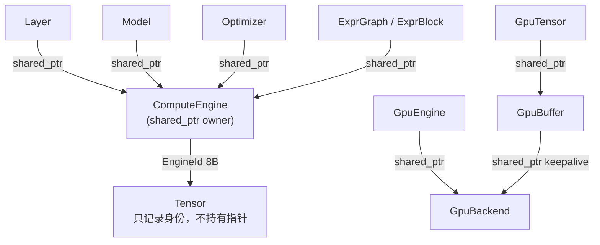

# 引擎所有权与 EngineId（对象生命周期 v2）

> 适用范围：`ComputeEngine`、`GpuBackend`、`CpuEngine` / `GpuEngine`、
> `Layer`、`Model`、`Optimizer`、`Tensor`、`ExprGraph` / `ExprBlock`。
>
> 本文替代 [`08-object-lifetimes.md`](08-object-lifetimes.md) 中“借用令牌”
> 的实现部分；08 仍保留为旧版契约的历史说明。

## 1. 目标与非目标

要解决的问题：

1. `GpuBackend::instance()` 的进程级 `new` 永不释放（Vulkan device / instance /
   pipeline / memory pool 全部泄漏）；
2. `EngineTokenPool` 只增不减，每个引擎永久占一块存活令牌；
3. `EngineLease::require()` 是 check-then-use：`alive()` 与解引用之间没有
   所有权保护，并发销毁时仍是 UAF；
4. `GpuBuffer::~GpuBuffer()` 通过全局 `GpuBackend::instance()` 取 backend，
   buffer 晚于 backend 析构时是 UAF；
5. 现有 `GpuBackend` 成员 `reduce_partial_` 的析构顺序本身就会访问已释放的
   memory pool（只因 backend 永不析构而被掩盖）。

目标：

- **Tensor 侧零指针**：Tensor 可以安全地晚于引擎析构；复制 Tensor 不增加
  原子引用计数；
- **借用方侧强所有权**：任何会解引用引擎的对象都必须持有引擎的强引用，
  不依赖“引擎最后析构”的代码约定；
- **RAII**：最后一个强引用释放时，引擎、backend、Vulkan 资源、内存池按序
  析构；
- **无悬垂指针 / 无 use-after-free / 无 check-then-use**；
- **尺寸与热路径成本可控**：Tensor 保持 8 字节引擎身份字段，`sizeof(Tensor)`
  不变；Tensor 拷贝不做原子操作。

非目标：

- 不引入 Boost 或其他第三方库；
- 不把整个 `Tensor` 变成 `shared_ptr` 句柄；
- 不承诺跨进程身份；`EngineId` 只在进程内唯一；
- 不保留“栈上引擎 + 借用方长期存活”这种无法由类型系统保证安全的用法。

## 2. 所有权模型



两条独立的生命周期：

1. **Tensor 的生命周期**：Tensor 只是数据句柄。它记录“出生引擎”的
   `EngineId`，用于跨引擎混用的诊断；它不保存 `ComputeEngine*`，因此
   Tensor 晚于引擎析构是合法且安全的。
2. **计算对象的生命周期**：`Layer` / `Model` / `Optimizer` / `ExprGraph`
   需要真正调用引擎。它们持有 `std::shared_ptr<ComputeEngine>`，只要它们
   还活着，引擎就不会析构。

`GpuBuffer` 是 GPU 存储的 RAII 所有者。它持有
`std::shared_ptr<GpuBackend>`，因此 GPU Tensor 可以晚于 `GpuEngine` 存活；
backend 会一直活到最后一个 buffer 被销毁。

## 3. EngineId

```cpp
class EngineId
{
public:
    constexpr EngineId() noexcept = default;       // 0 = 未绑定
    explicit constexpr EngineId(std::uint64_t v) noexcept;
    [[nodiscard]] constexpr bool bound() const noexcept;
    [[nodiscard]] constexpr std::uint64_t value() const noexcept;
    friend constexpr bool operator==(EngineId, EngineId) noexcept = default;
};

static_assert(sizeof(EngineId) == 8);
static_assert(std::is_trivially_copyable_v<EngineId>);
```

规则：

- 每个 `ComputeEngine` 构造时从进程级 `std::atomic<std::uint64_t>` 取得一个
  非零 ID；
- ID **单调递增、永不复用**；旧 Tensor 的 ID 永远不会和新引擎相同；
- `Tensor::engine_id()` 返回该值；`Tensor::bound()` 即 `engine_id().bound()`；
- 绑定检查只比较 ID，不解引用任何指针；
- 引擎析构后，旧 Tensor 仍可安全复制、读取形状、释放存储；用新引擎消费它
  会得到明确的 “mixed engines” 错误，而不是静默错值。

### 3.1 为什么不是“令牌地址”

旧方案的 `EngineLiveness*` 同时承担“身份”和“存活查询”。它要求令牌地址永不
复用，因此必须永久保留令牌，形成只增不减的池。新方案把身份压成整数：

- 不需要令牌池；
- 不需要释放顺序；
- 不会把新引擎误认成旧引擎（ID 不复用）；
- Tensor 拷贝退化为一次 8 字节整数复制。

### 3.2 Tensor 不再提供 `engine()` / `engine_alive()`

这两个 API 的本质都是“从 Tensor 找回引擎指针”。在 Tensor 只存 ID 后：

- `Tensor::engine()` 被删除；需要引擎的代码应由调用方显式传入，或由
  `Layer` / `Model` / `Optimizer` 自己的强引用取得；
- `Tensor::engine_alive()` 被删除；Tensor 不查询引擎存活，也不参与引擎
  生命周期判断；
- 原来的 `bound()` 保留，语义收窄为“记录过出生引擎身份”。

这是有意的 API 收口：Tensor 是数据，不是引擎句柄。

## 4. 引擎创建与借用

### 4.1 工厂

引擎不再允许栈上构造，避免“借用方持有强引用但引擎在栈上”这一无法安全
实现的组合：

```cpp
auto cpu = nn::CpuEngine::create();      // std::shared_ptr<CpuEngine>

#ifdef NN_HAS_VULKAN
auto backend = nn::GpuBackend::shared(); // 进程共享，RAII 析构
auto gpu = nn::GpuEngine::create(backend);
#endif
```

`CpuEngine` / `GpuEngine` 的构造函数私有，`create()` 返回 `shared_ptr`。
因此 `Layer::init(engine)` 拿到的引擎一定可以被 `weak_from_this().lock()`
安全地提升为强引用。

### 4.2 Layer

```cpp
class Layer
{
    std::shared_ptr<ComputeEngine> engine_;
    BindingState binding_state_ = BindingState::unbound;

    ComputeEngine& engine_ref() const; // 空指针 → fail-fast
};
```

`init(ComputeEngine& engine)` 的签名保持不变，内部把
`engine.weak_from_this().lock()` 存为强引用。这样：

- 正常路径：`Model` / 用户持有引擎时，层也持有一份；引擎至少活到最后一个
  层析构；
- 错误路径：引擎不是 `shared_ptr` 管理 → `Result` 错误，层保持未绑定；
- 跨引擎重绑仍然拒绝（比较 `engine_.get()`）。

`Layer::engine_alive()` 保留为“是否已有强引用”的诊断，不再表示“借用令牌
是否仍有效”。

### 4.3 Model / Optimizer / ExprGraph

- `Model` 持有 `std::shared_ptr<ComputeEngine>`；`Model::engine()` 直接
  返回 `*engine_`；
- `Optimizer` 持有 `std::shared_ptr<ComputeEngine>`（引用成员绑定到
  `*owner`），优化器晚于 Model 存活也安全；
- `ExprGraph::owner` 与 `ExprBlock::eng` 持有强引用；录制段内引擎不会
  析构。

这些对象的数量远小于 Tensor 的数量，`shared_ptr` 的 16 字节和原子计数
不在热路径上。

## 5. GpuBackend / GpuBuffer

### 5.1 backend 共享所有权

```cpp
class GpuBackend : public std::enable_shared_from_this<GpuBackend>
{
public:
    static std::shared_ptr<GpuBackend> shared(); // 进程共享实例
    static std::shared_ptr<GpuBackend> create(); // 独立实例（测试/多设备）
};
```

`shared()` 使用函数局部 `static std::shared_ptr<GpuBackend>`，不再 `new` 后
故意泄漏。最后一个引用释放时 `~GpuBackend()` 正常执行：

1. `vkDeviceWaitIdle`；
2. 释放 scratch（`reduce_partial_` 改为 backend 自有的裸 `VkBuffer`，不再
   持有 `GpuTensor`，避免 `backend → GpuTensor → GpuBuffer → backend` 环）；
3. `flush_pending_destroys()`；
4. 释放标量回读槽、staging ring、fence、descriptor/query/command pool；
5. reset memory pools；
6. 最后析构 `VulkanDevice`。

### 5.2 GpuBuffer keepalive

`GpuBuffer` 新增 `std::shared_ptr<GpuBackend> backend_`。析构时：

- 若 backend 仍在飞行录制中 → 通过自己持有的 backend 引用登记延迟销毁；
- 否则立即 `vkDestroyBuffer` + 归还 memory pool；
- 不再调用 `GpuBackend::instance()`，因此没有“全局单例已死”的窗口。

`GpuBuffer` 的尺寸增加 16 字节，但 Tensor 只持有 `GpuTensor` 的
`shared_ptr`，不会在 Tensor 拷贝路径上复制这个 keepalive。

## 6. 失败语义

| 场景 | 结果 |
|---|---|
| 引擎不是 `shared_ptr` 管理 | `Layer::init` / `Model` 构造 / `Optimizer` 构造返回明确错误 |
| 层已绑定引擎 A，再次 `init(B)` | `Result` 错误，保持 A |
| Tensor 由引擎 A 创建，交给引擎 B 使用 | `Result` 错误 `mixed engines` |
| Tensor 的引擎已析构 | Tensor 仍可复制/读取元数据/析构；不提供 `engine()` |
| `GpuEngine` 析构但 Tensor 仍存活 | `GpuBuffer` 的 backend keepalive 保证 backend 存活 |
| backend 析构 | 只会在所有 buffer 释放后发生；资源按序释放 |

所有失败都发生在 `Result` 或构造期诊断，不依赖“调用方记得让引擎最后析构”。

## 7. 性能口径

| 对象/操作 | 旧方案 | 新方案 |
|---|---|---|
| `sizeof(Tensor)` | CPU 构建 64 B / GPU 构建 88 B | 同宽（`EngineLease` 8 B → `EngineId` 8 B；GPU variant 不变） |
| Tensor copy+destroy | ~7.2 ns（旧基准） | **7.66 ns**（2026-10-18 本机 clang 24 / libstdc++ 16 / -O3 复测；只复制整数） |
| Tensor 拷贝原子操作 | 0 | 0 |
| `sizeof(Layer)` | 约 8 B 引擎字段 | +8 B（shared_ptr 16 B，替换 8 B lease） |
| `Layer::engine_ref()` | 一次 acquire load | 一次指针读取（强引用已保证存活） |
| `Model` 构造/析构 | 一次 lease | 一次 shared_ptr 原子增减 |
| 同时存活 Tensor 数量 | 10²–10⁵ | 同量级；无额外 per-Tensor 控制块 |

本机实测：CPU 构建 `sizeof(Tensor)=64 B`、GPU 构建 `sizeof(Tensor)=88 B`、
`sizeof(EngineId)=8 B`。Tensor 拷贝次数在
表达式、层缓存、模型输入级别是“每个算子/每层”量级，不是“每个矩阵元素”
量级；因此 8B 身份字段的复制成本可以忽略，真正昂贵的 `shared_ptr` 原子计数
只出现在少量 Layer/Model/Optimizer 所有者上。

结论：EngineId 把成本从“每个 Tensor 拷贝一次原子操作”移到“每个 Engine
所有者一次 shared_ptr 计数”。这正是当前使用形态下最划算的交换。

### 7.1 为什么不用 intrusive_ptr

侵入式指针能把所有者句柄压到 8 B，但：

- 需要引擎内嵌引用计数和自定义 `add_ref` / `release`；
- 需要自己处理 copy/move/reset/自赋值/最后引用销毁；
- 引擎必须是堆对象；
- 仍然不能消除所有者侧的原子操作。

所有者（Layer/Model/Optimizer）数量是几十到几百，16 B 和一次控制块分配
可以忽略；Tensor 才是万级到十万级。先用标准 `shared_ptr` 保证正确性，若
未来 profile 证明所有者拷贝成为瓶颈，再在 `EngineHandle` 内部替换为
intrusive_ptr，不影响 Tensor 的 EngineId 设计。

## 8. 改动范围

### 8.1 新增/替换

| 文件 | 改动 |
|---|---|
| `include/neuralnet.cpp/core_engine_id.hpp` | 新增 `EngineId`、进程级 ID 分配器 |
| `include/neuralnet.cpp/core_engine_lease.hpp` | 删除 `EngineLiveness` / `EngineTokenPool`；保留兼容转发（只含 EngineId） |
| `include/neuralnet.cpp/compute_engine.hpp` | `enable_shared_from_this`、`id()`、`weak_from_this` 绑定 |
| `include/neuralnet.cpp/compute_tensor.hpp` | `EngineLease engine_` → `EngineId engine_id_`；删除 `engine()` / `engine_alive()` |
| `include/neuralnet.cpp/compute_cpu_engine.hpp` | 私有构造 + `create()` |
| `include/neuralnet.cpp/compute_gpu_engine.hpp` | `GpuBackend&` → `shared_ptr<GpuBackend>`；私有构造 + `create()` |
| `include/neuralnet.cpp/compute_layer_base.hpp` | `EngineLease` → `shared_ptr<ComputeEngine>` |
| `include/neuralnet.cpp/model_container.hpp` | 同上；构造时提升强引用 |
| `include/neuralnet.cpp/compute_optimizer.hpp` | 增加引擎 keepalive |
| `include/neuralnet.cpp/expr_graph.hpp` / `expr_dsl.hpp` | 录制图/ExprBlock 持强引用 |
| `include/neuralnet.cpp/backend/compute_vk_backend.hpp` | `shared()` / `create()`；`reduce_partial_` 改裸 scratch；析构顺序 |
| `include/neuralnet.cpp/backend/compute_gpu_storage.hpp` | `GpuBuffer` 持 backend keepalive |
| `include/neuralnet.cpp/backend/compute_gpu_tensor_impl.hpp` | 创建 buffer 时传入 keepalive |
| `include/neuralnet.cpp/cli/cli_engine_factory.hpp` | 返回 `shared_ptr<ComputeEngine>` |

### 8.2 调用点

- 所有 `nn::CpuEngine eng;` →
  `auto eng_owner = nn::CpuEngine::create(); nn::CpuEngine& eng = *eng_owner;`
- 所有 `nn::GpuEngine eng(backend);` →
  `auto eng_owner = nn::GpuEngine::create(backend); nn::GpuEngine& eng = *eng_owner;`
- 新代码也可直接用 `auto eng = nn::CpuEngine::create();`，此时引擎方法用
  `eng->foo()`，传给 `Layer::init` / `Model` 时用 `*eng`
- `GpuBackend::instance()` 保留为兼容入口（返回 `shared()` 的引用），新代码
  使用 `GpuBackend::shared()`

### 8.3 测试

新增/改写 `src/layer_lifetime_test.cpp`：

1. `EngineId` 8 B / 平凡复制 / 不复用；
2. Tensor 晚于引擎析构仍可复制和析构；
3. Layer/Model/Optimizer 持有引擎强引用：引擎局部变量离开作用域后仍可
   forward/step；
4. 跨引擎使用返回 `mixed engines`；
5. `GpuBuffer` 晚于 `GpuEngine` 析构（GPU 构建下）；
6. 重复创建/销毁 engine/backend 不增长（LSan/ASan 下运行）。

## 9. 实施顺序

1. 加 `EngineId`，迁移 `ComputeEngine` / `Tensor`；
2. 迁移 `Layer` / `Model` / `Optimizer` / `ExprGraph`；
3. 引擎工厂与 CLI；
4. `GpuBackend` / `GpuBuffer` 共享所有权与析构顺序；
5. 测试、文档、性能复测。

每一步先保证 CPU 构建和 `layer_lifetime_test` 通过，再进入 GPU 步骤。

## 10. 实施状态（2026-10-18）

- [x] `EngineId` + `ComputeEngine::id()` / `enable_shared_from_this`；
- [x] `Tensor` 改存 `engine_id_`，删除 `engine()` / `engine_alive()`；
- [x] `Layer` / `Model` / `Optimizer` / `ExprGraph` / `ExprBlock` 强引用；
- [x] `CpuEngine::create()` / `GpuEngine::create()`，栈上构造编译失败；
- [x] `GpuBackend::shared()` / `create()`，删除故意泄漏；
- [x] `GpuBuffer` backend keepalive；`reduce_partial_` 改裸 scratch；
- [x] CPU ctest 53/53、`NN_BIND_DEBUG=1` 53/53；
- [x] GPU ctest 55/55（本机 850M）；
- [x] `layer_lifetime_test` 在 ASan/LSan/UBSan 下通过；
- [x] Tensor copy+destroy 本机复测 7.66 ns；`sizeof(Tensor)` = CPU 64 B /
  GPU 88 B（字段宽度与旧版一致）。
