# 架构地图（自动生成）

> ⚠️ 本文件由 `scripts/gen_arch_map.py` 从源码生成，**请勿手工编辑**。
> 重新生成：`python3 scripts/gen_arch_map.py`。
> 用途：人类主导者与 AI 建立共享心智模型的**第一入口**——先读本页，再按需下钻单文件。

## 1. 规模总览

- 库头文件：**79 个**，共 **44,525 行**（header-only）
- 可执行入口/测试：`src/` 下 81 个 .cpp
- 阅读顺序建议：`nn.hpp`（聚合入口）→ §2 分层 → §3 依赖图 → §4 逐文件清单

## 2. 分层视图（按文件名前缀自动归类）

| 层 | 文件数 | 行数 | 代表文件 |
|---|---|---|---|
| 基础设施（config/errors/tensor） | 10 | 3,140 | core_threadpool.hpp, core_profile.hpp, precision.hpp |
| 计算引擎核心 | 8 | 10,535 | compute_cpu_engine.hpp, compute_gpu_engine.hpp, compute_engine.hpp |
| 表达式 DSL / 算子融合 | 9 | 9,022 | expr_glsl_gen.hpp, expr_dsl.hpp, expr_spec.hpp |
| 网络层（compute_layer_*） | 10 | 7,808 | compute_layer_rapt.hpp, compute_layer_attention.hpp, compute_layer_mlp.hpp |
| GPU/Vulkan 后端 | 5 | 2,869 | compute_vk_backend.hpp, compute_vk_device.hpp, compute_memory_pool.hpp |
| 模型规格与序列化 | 4 | 2,563 | model_serialization.hpp, model_keyvalue_record.hpp, model_spec.hpp |
| 领域组件（GPT/tokenizer/dataset） | 8 | 2,991 | domain_tokenizer_base.hpp, domain_tokenizer_charbpe.hpp, domain_tokenizer_bpe.hpp |
| CLI 应用层 | 11 | 3,061 | text_train_loop.hpp, text_train_config.hpp, cli_help.hpp |
| 其他 | 14 | 2,536 | algebra_matrix.hpp, dataset.hpp, train_state.hpp |

## 3. 内部依赖图（#include 关系，仅库内边）

```mermaid
graph LR
    algebra_matrix --> algebra_span
    algebra_matrix --> compute_vk_backend
    algebra_matrix --> core_assert
    algebra_matrix --> core_config
    algebra_matrix --> core_errors
    algebra_matrix --> core_threadpool
    algebra_ops --> core_config
    algebra_ops --> expr_spec
    algebra_span --> core_config
    cli_engine_factory --> compute_cpu_engine
    cli_engine_factory --> compute_engine
    cli_engine_factory --> compute_gpu_engine
    cli_engine_factory --> core_errors
    cli_lr_scheduler --> core_config
    cli_mnist_io --> algebra_matrix
    cli_mnist_io --> compute_engine
    cli_mnist_io --> core_errors
    cli_mnist_io --> domain_mnist
    cli_mnist_io --> model_container
    cli_train_common --> cli_gpu_option
    cli_train_common --> core_config
    cli_train_common --> core_errors
    compute_cpu_engine --> compute_engine
    compute_cpu_engine --> expr_dsl
    compute_cpu_engine --> expr_op_table
    compute_cpu_engine --> expr_opt
    compute_cpu_engine --> expr_registry
    compute_cpu_engine --> ternary_pack
    compute_engine --> compute_tensor
    compute_engine --> core_config
    compute_engine --> core_env
    compute_engine --> core_errors
    compute_engine --> core_profile
    compute_engine --> expr_graph
    compute_engine --> expr_opt
    compute_engine --> expr_spec
    compute_gpu_engine --> compute_engine
    compute_gpu_engine --> compute_vk_backend
    compute_gpu_engine --> expr_dsl
    compute_gpu_engine --> expr_opt
    compute_gpu_engine --> ternary_pack
    compute_layer --> compute_layer_attention
    compute_layer --> compute_layer_base
    compute_layer --> compute_layer_bitlinear
    compute_layer --> compute_layer_conv
    compute_layer --> compute_layer_feedforward
    compute_layer --> compute_layer_gpt
    compute_layer --> compute_layer_mlp
    compute_layer --> compute_layer_rapt
    compute_layer --> compute_layer_softmax
    compute_layer --> compute_layer_transformer
    compute_layer --> compute_position_encoding
    compute_layer_attention --> compute_engine
    compute_layer_attention --> compute_layer_base
    compute_layer_attention --> compute_layer_mlp
    compute_layer_attention --> compute_layer_softmax
    compute_layer_attention --> compute_position_encoding
    compute_layer_attention --> compute_tensor
    compute_layer_attention --> expr_dsl
    compute_layer_attention --> expr_spec
    compute_layer_attention --> model_spec
    compute_layer_base --> compute_engine
    compute_layer_base --> compute_tensor
    compute_layer_base --> expr_dsl
    compute_layer_base --> model_spec
    compute_layer_base --> precision
    compute_layer_bitlinear --> compute_engine
    compute_layer_bitlinear --> compute_layer_base
    compute_layer_bitlinear --> compute_tensor
    compute_layer_bitlinear --> expr_dsl
    compute_layer_bitlinear --> precision
    compute_layer_conv --> compute_engine
    compute_layer_conv --> compute_layer_base
    compute_layer_conv --> compute_tensor
    compute_layer_conv --> expr_dsl
    compute_layer_conv --> model_spec
    compute_layer_feedforward --> compute_engine
    compute_layer_feedforward --> compute_layer_base
    compute_layer_feedforward --> compute_layer_mlp
    compute_layer_feedforward --> compute_tensor
    compute_layer_feedforward --> expr_dsl
    compute_layer_feedforward --> model_spec
    compute_layer_gpt --> compute_engine
    compute_layer_gpt --> compute_layer_attention
    compute_layer_gpt --> compute_layer_base
    compute_layer_gpt --> compute_layer_feedforward
    compute_layer_gpt --> compute_layer_mlp
    compute_layer_gpt --> compute_position_encoding
    compute_layer_gpt --> compute_tensor
    compute_layer_gpt --> expr_dsl
    compute_layer_gpt --> model_spec
    compute_layer_mlp --> compute_engine
    compute_layer_mlp --> compute_layer_base
    compute_layer_mlp --> compute_layer_bitlinear
    compute_layer_mlp --> compute_tensor
    compute_layer_mlp --> expr_dsl
    compute_layer_mlp --> model_spec
    compute_layer_rapt --> compute_engine
    compute_layer_rapt --> compute_layer_attention
    compute_layer_rapt --> compute_layer_base
    compute_layer_rapt --> compute_layer_feedforward
    compute_layer_rapt --> compute_layer_gpt
    compute_layer_rapt --> compute_layer_mlp
    compute_layer_rapt --> compute_tensor
    compute_layer_rapt --> expr_dsl
    compute_layer_rapt --> model_spec
    compute_layer_softmax --> compute_engine
    compute_layer_softmax --> compute_layer_base
    compute_layer_softmax --> compute_tensor
    compute_layer_softmax --> expr_dsl
    compute_layer_softmax --> model_spec
    compute_layer_transformer --> compute_engine
    compute_layer_transformer --> compute_layer_attention
    compute_layer_transformer --> compute_layer_base
    compute_layer_transformer --> compute_layer_feedforward
    compute_layer_transformer --> compute_layer_mlp
    compute_layer_transformer --> compute_tensor
    compute_layer_transformer --> expr_dsl
    compute_layer_transformer --> model_spec
    compute_loss --> compute_engine
    compute_loss --> compute_layer_base
    compute_loss --> compute_tensor
    compute_loss --> expr_dsl
    compute_loss --> expr_fold
    compute_memory_pool --> core_errors
    compute_optimizer --> compute_engine
    compute_optimizer --> compute_layer_base
    compute_optimizer --> compute_tensor
    compute_optimizer --> expr_dsl
    compute_position_encoding --> compute_layer_base
    compute_staging_ring --> compute_memory_pool
    compute_staging_ring --> core_config
    compute_staging_ring --> core_errors
    compute_staging_ring --> core_observer_ptr
    compute_tensor --> algebra_matrix
    compute_tensor --> compute_vk_backend
    compute_tensor --> core_config
    compute_tensor --> core_errors
    compute_tensor --> core_observer_ptr
    compute_tensor --> precision
    compute_vk_backend --> compute_memory_pool
    compute_vk_backend --> compute_staging_ring
    compute_vk_backend --> compute_vk_device
    compute_vk_backend --> core_config
    compute_vk_backend --> core_errors
    compute_vk_backend --> core_observer_ptr
    compute_vk_backend --> core_profile
    compute_vk_backend --> expr_spec
    compute_vk_device --> core_config
    compute_vk_device --> core_env
    compute_vk_device --> core_errors
    core_assert --> core_errors
    core_config --> core_errors
    core_config --> core_threadpool
    core_config --> precision
    core_env --> core_config
    core_file --> core_errors
    core_file --> core_sha256
    core_profile --> core_env
    core_threadpool --> core_assert
    dataset --> core_errors
    dataset --> core_file
    dataset --> core_sha256
    dataset --> dataset_format
    dataset --> model_keyvalue_record
    dataset_format --> core_errors
    dataset_format --> model_keyvalue_record
    domain_cnn --> compute_engine
    domain_cnn --> core_errors
    domain_cnn --> model_container
    domain_cnn --> model_spec
    domain_gpt --> compute_engine
    domain_gpt --> core_errors
    domain_gpt --> model_container
    domain_gpt --> model_spec
    domain_gpt --> precision
    domain_mnist --> compute_engine
    domain_mnist --> core_errors
    domain_mnist --> domain_cnn
    domain_mnist --> model_container
    domain_mnist --> model_spec
    domain_rla --> compute_engine
    domain_rla --> core_errors
    domain_rla --> domain_gpt
    domain_rla --> model_container
    domain_rla --> model_spec
    domain_rla --> precision
    domain_tokenizer --> domain_tokenizer_base
    domain_tokenizer --> domain_tokenizer_bpe
    domain_tokenizer --> domain_tokenizer_charbpe
    domain_tokenizer_base --> core_config
    domain_tokenizer_base --> dataset_format
    domain_tokenizer_bpe --> core_config
    domain_tokenizer_bpe --> domain_tokenizer_base
    domain_tokenizer_charbpe --> core_config
    domain_tokenizer_charbpe --> domain_tokenizer_base
    domain_tokenizer_charbpe --> domain_tokenizer_bpe
    engine --> compute_cpu_engine
    engine --> compute_engine
    engine --> compute_gpu_engine
    expr_dsl --> algebra_matrix
    expr_dsl --> algebra_ops
    expr_dsl --> compute_engine
    expr_dsl --> compute_tensor
    expr_dsl --> core_assert
    expr_dsl --> core_config
    expr_dsl --> core_env
    expr_dsl --> expr_registry
    expr_dsl --> expr_spec
    expr_emitter --> expr_spec
    expr_fold --> expr_dsl
    expr_fold --> expr_spec
    expr_glsl_gen --> expr_emitter
    expr_glsl_gen --> expr_op_table
    expr_glsl_gen --> expr_spec
    expr_graph --> compute_tensor
    expr_graph --> expr_opt
    expr_graph --> expr_spec
    expr_graph --> precision
    expr_op_table --> algebra_ops
    expr_opt --> expr_op_table
    expr_opt --> expr_spec
    expr_registry --> expr_opt
    expr_registry --> expr_spec
    expr_spec --> core_config
    expr_spec --> core_errors
    layer --> compute_layer
    loss --> compute_loss
    model --> model_container
    model --> model_serialization
    model --> model_spec
    model_container --> compute_layer
    model_container --> core_assert
    model_container --> core_observer_ptr
    model_container --> model_spec
    model_keyvalue_record --> core_errors
    model_serialization --> compute_layer
    model_serialization --> core_config
    model_serialization --> core_file
    model_serialization --> core_sha256
    model_serialization --> model_container
    model_serialization --> model_keyvalue_record
    model_serialization --> model_spec
    model_serialization --> train_state
    nn --> algebra_matrix
    nn --> compute_cpu_engine
    nn --> compute_engine
    nn --> compute_gpu_engine
    nn --> compute_layer
    nn --> compute_loss
    nn --> compute_optimizer
    nn --> compute_tensor
    nn --> core_assert
    nn --> core_config
    nn --> core_errors
    nn --> core_file
    nn --> core_observer_ptr
    nn --> core_threadpool
    nn --> dataset
    nn --> domain_cnn
    nn --> domain_gpt
    nn --> domain_mnist
    nn --> domain_rla
    nn --> domain_tokenizer
    nn --> expr_dsl
    nn --> expr_spec
    nn --> model_container
    nn --> model_serialization
    nn --> model_spec
    optimizer --> compute_optimizer
    precision --> core_errors
    text_train_checkpoint --> core_errors
    text_train_checkpoint --> model_container
    text_train_checkpoint --> model_serialization
    text_train_checkpoint --> model_spec
    text_train_checkpoint --> train_state
    text_train_config --> cli_gpu_option
    text_train_config --> compute_optimizer
    text_train_config --> core_config
    text_train_config --> core_errors
    text_train_config --> domain_gpt
    text_train_config --> model_spec
    text_train_config --> precision
    text_train_loop --> algebra_matrix
    text_train_loop --> cli_lr_scheduler
    text_train_loop --> compute_engine
    text_train_loop --> compute_loss
    text_train_loop --> compute_optimizer
    text_train_loop --> core_config
    text_train_loop --> core_errors
    text_train_loop --> core_profile
    text_train_loop --> dataset
    text_train_loop --> model_container
    text_train_loop --> model_spec
    text_train_loop --> text_train_checkpoint
    text_train_loop --> text_train_config
    text_train_recovery --> compute_engine
    text_train_recovery --> compute_layer_base
    text_train_recovery --> compute_optimizer
    text_train_recovery --> core_errors
    text_train_recovery --> domain_gpt
    text_train_recovery --> domain_rla
    text_train_recovery --> model_container
    text_train_recovery --> model_serialization
    text_train_recovery --> model_spec
    text_train_recovery --> text_train_config
    text_train_recovery --> train_state
    train --> engine
    train --> layer
    train --> loss
    train --> model
    train --> optimizer
    train_state --> core_config
    train_state --> model_keyvalue_record
    train_state --> precision
    %% 另有 7 条叶子/外围边未画出（阈值：度数≥2）
```



完整边清单（`源 依赖 目标`，即 src include dst）：

```text
algebra_matrix.hpp  -->  algebra_span.hpp
algebra_matrix.hpp  -->  compute_gpu_tensor_impl.hpp
algebra_matrix.hpp  -->  compute_vk_backend.hpp
algebra_matrix.hpp  -->  core_assert.hpp
algebra_matrix.hpp  -->  core_config.hpp
algebra_matrix.hpp  -->  core_errors.hpp
algebra_matrix.hpp  -->  core_threadpool.hpp
algebra_ops.hpp  -->  core_config.hpp
algebra_ops.hpp  -->  expr_spec.hpp
algebra_span.hpp  -->  core_config.hpp
cli_engine_factory.hpp  -->  compute_cpu_engine.hpp
cli_engine_factory.hpp  -->  compute_engine.hpp
cli_engine_factory.hpp  -->  compute_gpu_engine.hpp
cli_engine_factory.hpp  -->  core_errors.hpp
cli_lr_scheduler.hpp  -->  core_config.hpp
cli_mnist_io.hpp  -->  algebra_matrix.hpp
cli_mnist_io.hpp  -->  compute_engine.hpp
cli_mnist_io.hpp  -->  core_errors.hpp
cli_mnist_io.hpp  -->  domain_mnist.hpp
cli_mnist_io.hpp  -->  model_container.hpp
cli_precision_warning.hpp  -->  precision.hpp
cli_train_common.hpp  -->  cli_gpu_option.hpp
cli_train_common.hpp  -->  core_config.hpp
cli_train_common.hpp  -->  core_errors.hpp
compute_cpu_engine.hpp  -->  compute_engine.hpp
compute_cpu_engine.hpp  -->  expr_dsl.hpp
compute_cpu_engine.hpp  -->  expr_op_table.hpp
compute_cpu_engine.hpp  -->  expr_opt.hpp
compute_cpu_engine.hpp  -->  expr_registry.hpp
compute_cpu_engine.hpp  -->  ternary_pack.hpp
compute_engine.hpp  -->  compute_tensor.hpp
compute_engine.hpp  -->  core_config.hpp
compute_engine.hpp  -->  core_env.hpp
compute_engine.hpp  -->  core_errors.hpp
compute_engine.hpp  -->  core_profile.hpp
compute_engine.hpp  -->  expr_graph.hpp
compute_engine.hpp  -->  expr_opt.hpp
compute_engine.hpp  -->  expr_spec.hpp
compute_gpu_engine.hpp  -->  compute_engine.hpp
compute_gpu_engine.hpp  -->  compute_vk_backend.hpp
compute_gpu_engine.hpp  -->  expr_dsl.hpp
compute_gpu_engine.hpp  -->  expr_opt.hpp
compute_gpu_engine.hpp  -->  ternary_pack.hpp
compute_layer.hpp  -->  compute_layer_attention.hpp
compute_layer.hpp  -->  compute_layer_base.hpp
compute_layer.hpp  -->  compute_layer_bitlinear.hpp
compute_layer.hpp  -->  compute_layer_conv.hpp
compute_layer.hpp  -->  compute_layer_feedforward.hpp
compute_layer.hpp  -->  compute_layer_gpt.hpp
compute_layer.hpp  -->  compute_layer_mlp.hpp
compute_layer.hpp  -->  compute_layer_rapt.hpp
compute_layer.hpp  -->  compute_layer_softmax.hpp
compute_layer.hpp  -->  compute_layer_transformer.hpp
compute_layer.hpp  -->  compute_position_encoding.hpp
compute_layer_attention.hpp  -->  compute_engine.hpp
compute_layer_attention.hpp  -->  compute_layer_base.hpp
compute_layer_attention.hpp  -->  compute_layer_mlp.hpp
compute_layer_attention.hpp  -->  compute_layer_softmax.hpp
compute_layer_attention.hpp  -->  compute_position_encoding.hpp
compute_layer_attention.hpp  -->  compute_tensor.hpp
compute_layer_attention.hpp  -->  expr_dsl.hpp
compute_layer_attention.hpp  -->  expr_spec.hpp
compute_layer_attention.hpp  -->  model_spec.hpp
compute_layer_base.hpp  -->  compute_engine.hpp
compute_layer_base.hpp  -->  compute_tensor.hpp
compute_layer_base.hpp  -->  expr_dsl.hpp
compute_layer_base.hpp  -->  model_spec.hpp
compute_layer_base.hpp  -->  precision.hpp
compute_layer_bitlinear.hpp  -->  compute_engine.hpp
compute_layer_bitlinear.hpp  -->  compute_layer_base.hpp
compute_layer_bitlinear.hpp  -->  compute_tensor.hpp
compute_layer_bitlinear.hpp  -->  expr_dsl.hpp
compute_layer_bitlinear.hpp  -->  precision.hpp
compute_layer_conv.hpp  -->  compute_engine.hpp
compute_layer_conv.hpp  -->  compute_layer_base.hpp
compute_layer_conv.hpp  -->  compute_tensor.hpp
compute_layer_conv.hpp  -->  expr_dsl.hpp
compute_layer_conv.hpp  -->  model_spec.hpp
compute_layer_feedforward.hpp  -->  compute_engine.hpp
compute_layer_feedforward.hpp  -->  compute_layer_base.hpp
compute_layer_feedforward.hpp  -->  compute_layer_mlp.hpp
compute_layer_feedforward.hpp  -->  compute_tensor.hpp
compute_layer_feedforward.hpp  -->  expr_dsl.hpp
compute_layer_feedforward.hpp  -->  model_spec.hpp
compute_layer_gpt.hpp  -->  compute_engine.hpp
compute_layer_gpt.hpp  -->  compute_layer_attention.hpp
compute_layer_gpt.hpp  -->  compute_layer_base.hpp
compute_layer_gpt.hpp  -->  compute_layer_feedforward.hpp
compute_layer_gpt.hpp  -->  compute_layer_mlp.hpp
compute_layer_gpt.hpp  -->  compute_position_encoding.hpp
compute_layer_gpt.hpp  -->  compute_tensor.hpp
compute_layer_gpt.hpp  -->  expr_dsl.hpp
compute_layer_gpt.hpp  -->  model_spec.hpp
compute_layer_mlp.hpp  -->  compute_engine.hpp
compute_layer_mlp.hpp  -->  compute_layer_base.hpp
compute_layer_mlp.hpp  -->  compute_layer_bitlinear.hpp
compute_layer_mlp.hpp  -->  compute_tensor.hpp
compute_layer_mlp.hpp  -->  expr_dsl.hpp
compute_layer_mlp.hpp  -->  model_spec.hpp
compute_layer_rapt.hpp  -->  compute_engine.hpp
compute_layer_rapt.hpp  -->  compute_layer_attention.hpp
compute_layer_rapt.hpp  -->  compute_layer_base.hpp
compute_layer_rapt.hpp  -->  compute_layer_feedforward.hpp
compute_layer_rapt.hpp  -->  compute_layer_gpt.hpp
compute_layer_rapt.hpp  -->  compute_layer_mlp.hpp
compute_layer_rapt.hpp  -->  compute_tensor.hpp
compute_layer_rapt.hpp  -->  expr_dsl.hpp
compute_layer_rapt.hpp  -->  model_spec.hpp
compute_layer_softmax.hpp  -->  compute_engine.hpp
compute_layer_softmax.hpp  -->  compute_layer_base.hpp
compute_layer_softmax.hpp  -->  compute_tensor.hpp
compute_layer_softmax.hpp  -->  expr_dsl.hpp
compute_layer_softmax.hpp  -->  model_spec.hpp
compute_layer_transformer.hpp  -->  compute_engine.hpp
compute_layer_transformer.hpp  -->  compute_layer_attention.hpp
compute_layer_transformer.hpp  -->  compute_layer_base.hpp
compute_layer_transformer.hpp  -->  compute_layer_feedforward.hpp
compute_layer_transformer.hpp  -->  compute_layer_mlp.hpp
compute_layer_transformer.hpp  -->  compute_tensor.hpp
compute_layer_transformer.hpp  -->  expr_dsl.hpp
compute_layer_transformer.hpp  -->  model_spec.hpp
compute_loss.hpp  -->  compute_engine.hpp
compute_loss.hpp  -->  compute_layer_base.hpp
compute_loss.hpp  -->  compute_tensor.hpp
compute_loss.hpp  -->  expr_dsl.hpp
compute_loss.hpp  -->  expr_fold.hpp
compute_memory_pool.hpp  -->  core_errors.hpp
compute_optimizer.hpp  -->  compute_engine.hpp
compute_optimizer.hpp  -->  compute_layer_base.hpp
compute_optimizer.hpp  -->  compute_tensor.hpp
compute_optimizer.hpp  -->  expr_dsl.hpp
compute_position_encoding.hpp  -->  compute_layer_base.hpp
compute_staging_ring.hpp  -->  compute_memory_pool.hpp
compute_staging_ring.hpp  -->  core_config.hpp
compute_staging_ring.hpp  -->  core_errors.hpp
compute_staging_ring.hpp  -->  core_observer_ptr.hpp
compute_tensor.hpp  -->  algebra_matrix.hpp
compute_tensor.hpp  -->  compute_vk_backend.hpp
compute_tensor.hpp  -->  core_config.hpp
compute_tensor.hpp  -->  core_errors.hpp
compute_tensor.hpp  -->  core_observer_ptr.hpp
compute_tensor.hpp  -->  precision.hpp
compute_vk_backend.hpp  -->  compute_memory_pool.hpp
compute_vk_backend.hpp  -->  compute_staging_ring.hpp
compute_vk_backend.hpp  -->  compute_vk_backend_destroy.inc
compute_vk_backend.hpp  -->  compute_vk_backend_frame.inc
compute_vk_backend.hpp  -->  compute_vk_backend_ops.inc
compute_vk_backend.hpp  -->  compute_vk_backend_pipelines.inc
compute_vk_backend.hpp  -->  compute_vk_device.hpp
compute_vk_backend.hpp  -->  core_config.hpp
compute_vk_backend.hpp  -->  core_errors.hpp
compute_vk_backend.hpp  -->  core_observer_ptr.hpp
compute_vk_backend.hpp  -->  core_profile.hpp
compute_vk_backend.hpp  -->  expr_spec.hpp
compute_vk_device.hpp  -->  core_config.hpp
compute_vk_device.hpp  -->  core_env.hpp
compute_vk_device.hpp  -->  core_errors.hpp
core_assert.hpp  -->  core_errors.hpp
core_config.hpp  -->  core_errors.hpp
core_config.hpp  -->  core_threadpool.hpp
core_config.hpp  -->  precision.hpp
core_env.hpp  -->  core_config.hpp
core_file.hpp  -->  core_errors.hpp
core_file.hpp  -->  core_sha256.hpp
core_profile.hpp  -->  core_env.hpp
core_threadpool.hpp  -->  core_assert.hpp
dataset.hpp  -->  core_errors.hpp
dataset.hpp  -->  core_file.hpp
dataset.hpp  -->  core_sha256.hpp
dataset.hpp  -->  dataset_format.hpp
dataset.hpp  -->  model_keyvalue_record.hpp
dataset_format.hpp  -->  core_errors.hpp
dataset_format.hpp  -->  model_keyvalue_record.hpp
domain_cnn.hpp  -->  compute_engine.hpp
domain_cnn.hpp  -->  core_errors.hpp
domain_cnn.hpp  -->  model_container.hpp
domain_cnn.hpp  -->  model_spec.hpp
domain_gpt.hpp  -->  compute_engine.hpp
domain_gpt.hpp  -->  core_errors.hpp
domain_gpt.hpp  -->  model_container.hpp
domain_gpt.hpp  -->  model_spec.hpp
domain_gpt.hpp  -->  precision.hpp
domain_mnist.hpp  -->  compute_engine.hpp
domain_mnist.hpp  -->  core_errors.hpp
domain_mnist.hpp  -->  domain_cnn.hpp
domain_mnist.hpp  -->  model_container.hpp
domain_mnist.hpp  -->  model_spec.hpp
domain_rla.hpp  -->  compute_engine.hpp
domain_rla.hpp  -->  core_errors.hpp
domain_rla.hpp  -->  domain_gpt.hpp
domain_rla.hpp  -->  model_container.hpp
domain_rla.hpp  -->  model_spec.hpp
domain_rla.hpp  -->  precision.hpp
domain_tokenizer.hpp  -->  domain_tokenizer_base.hpp
domain_tokenizer.hpp  -->  domain_tokenizer_bpe.hpp
domain_tokenizer.hpp  -->  domain_tokenizer_charbpe.hpp
domain_tokenizer_base.hpp  -->  core_config.hpp
domain_tokenizer_base.hpp  -->  dataset_format.hpp
domain_tokenizer_bpe.hpp  -->  core_config.hpp
domain_tokenizer_bpe.hpp  -->  domain_tokenizer_base.hpp
domain_tokenizer_charbpe.hpp  -->  core_config.hpp
domain_tokenizer_charbpe.hpp  -->  domain_tokenizer_base.hpp
domain_tokenizer_charbpe.hpp  -->  domain_tokenizer_bpe.hpp
engine.hpp  -->  compute_cpu_engine.hpp
engine.hpp  -->  compute_engine.hpp
engine.hpp  -->  compute_gpu_engine.hpp
expr_dsl.hpp  -->  algebra_matrix.hpp
expr_dsl.hpp  -->  algebra_ops.hpp
expr_dsl.hpp  -->  compute_engine.hpp
expr_dsl.hpp  -->  compute_tensor.hpp
expr_dsl.hpp  -->  core_assert.hpp
expr_dsl.hpp  -->  core_config.hpp
expr_dsl.hpp  -->  core_env.hpp
expr_dsl.hpp  -->  expr_registry.hpp
expr_dsl.hpp  -->  expr_spec.hpp
expr_emitter.hpp  -->  expr_spec.hpp
expr_fold.hpp  -->  expr_dsl.hpp
expr_fold.hpp  -->  expr_spec.hpp
expr_glsl_gen.hpp  -->  expr_emitter.hpp
expr_glsl_gen.hpp  -->  expr_op_table.hpp
expr_glsl_gen.hpp  -->  expr_spec.hpp
expr_graph.hpp  -->  compute_tensor.hpp
expr_graph.hpp  -->  expr_opt.hpp
expr_graph.hpp  -->  expr_spec.hpp
expr_graph.hpp  -->  precision.hpp
expr_op_table.hpp  -->  algebra_ops.hpp
expr_opt.hpp  -->  expr_op_table.hpp
expr_opt.hpp  -->  expr_spec.hpp
expr_registry.hpp  -->  expr_opt.hpp
expr_registry.hpp  -->  expr_spec.hpp
expr_spec.hpp  -->  core_config.hpp
expr_spec.hpp  -->  core_errors.hpp
layer.hpp  -->  compute_layer.hpp
loss.hpp  -->  compute_loss.hpp
model.hpp  -->  model_container.hpp
model.hpp  -->  model_serialization.hpp
model.hpp  -->  model_spec.hpp
model_container.hpp  -->  compute_layer.hpp
model_container.hpp  -->  core_assert.hpp
model_container.hpp  -->  core_observer_ptr.hpp
model_container.hpp  -->  model_spec.hpp
model_keyvalue_record.hpp  -->  core_errors.hpp
model_serialization.hpp  -->  compute_layer.hpp
model_serialization.hpp  -->  core_config.hpp
model_serialization.hpp  -->  core_file.hpp
model_serialization.hpp  -->  core_sha256.hpp
model_serialization.hpp  -->  model_container.hpp
model_serialization.hpp  -->  model_keyvalue_record.hpp
model_serialization.hpp  -->  model_spec.hpp
model_serialization.hpp  -->  train_state.hpp
nn.hpp  -->  algebra_matrix.hpp
nn.hpp  -->  compute_cpu_engine.hpp
nn.hpp  -->  compute_engine.hpp
nn.hpp  -->  compute_gpu_engine.hpp
nn.hpp  -->  compute_layer.hpp
nn.hpp  -->  compute_loss.hpp
nn.hpp  -->  compute_optimizer.hpp
nn.hpp  -->  compute_tensor.hpp
nn.hpp  -->  core_assert.hpp
nn.hpp  -->  core_config.hpp
nn.hpp  -->  core_errors.hpp
nn.hpp  -->  core_file.hpp
nn.hpp  -->  core_observer_ptr.hpp
nn.hpp  -->  core_threadpool.hpp
nn.hpp  -->  dataset.hpp
nn.hpp  -->  domain_cnn.hpp
nn.hpp  -->  domain_gpt.hpp
nn.hpp  -->  domain_mnist.hpp
nn.hpp  -->  domain_rla.hpp
nn.hpp  -->  domain_tokenizer.hpp
nn.hpp  -->  expr_dsl.hpp
nn.hpp  -->  expr_spec.hpp
nn.hpp  -->  model_container.hpp
nn.hpp  -->  model_serialization.hpp
nn.hpp  -->  model_spec.hpp
optimizer.hpp  -->  compute_optimizer.hpp
precision.hpp  -->  core_errors.hpp
text_train_checkpoint.hpp  -->  core_errors.hpp
text_train_checkpoint.hpp  -->  model_container.hpp
text_train_checkpoint.hpp  -->  model_serialization.hpp
text_train_checkpoint.hpp  -->  model_spec.hpp
text_train_checkpoint.hpp  -->  train_state.hpp
text_train_config.hpp  -->  cli_gpu_option.hpp
text_train_config.hpp  -->  cli_help.hpp
text_train_config.hpp  -->  compute_optimizer.hpp
text_train_config.hpp  -->  core_config.hpp
text_train_config.hpp  -->  core_errors.hpp
text_train_config.hpp  -->  domain_gpt.hpp
text_train_config.hpp  -->  model_spec.hpp
text_train_config.hpp  -->  precision.hpp
text_train_loop.hpp  -->  algebra_matrix.hpp
text_train_loop.hpp  -->  cli_lr_scheduler.hpp
text_train_loop.hpp  -->  compute_engine.hpp
text_train_loop.hpp  -->  compute_loss.hpp
text_train_loop.hpp  -->  compute_optimizer.hpp
text_train_loop.hpp  -->  core_config.hpp
text_train_loop.hpp  -->  core_errors.hpp
text_train_loop.hpp  -->  core_profile.hpp
text_train_loop.hpp  -->  dataset.hpp
text_train_loop.hpp  -->  model_container.hpp
text_train_loop.hpp  -->  model_spec.hpp
text_train_loop.hpp  -->  text_train_checkpoint.hpp
text_train_loop.hpp  -->  text_train_config.hpp
text_train_recovery.hpp  -->  compute_engine.hpp
text_train_recovery.hpp  -->  compute_layer_base.hpp
text_train_recovery.hpp  -->  compute_optimizer.hpp
text_train_recovery.hpp  -->  core_errors.hpp
text_train_recovery.hpp  -->  domain_gpt.hpp
text_train_recovery.hpp  -->  domain_rla.hpp
text_train_recovery.hpp  -->  model_container.hpp
text_train_recovery.hpp  -->  model_serialization.hpp
text_train_recovery.hpp  -->  model_spec.hpp
text_train_recovery.hpp  -->  text_train_config.hpp
text_train_recovery.hpp  -->  train_state.hpp
train.hpp  -->  engine.hpp
train.hpp  -->  layer.hpp
train.hpp  -->  loss.hpp
train.hpp  -->  model.hpp
train.hpp  -->  optimizer.hpp
train_state.hpp  -->  core_config.hpp
train_state.hpp  -->  model_keyvalue_record.hpp
train_state.hpp  -->  precision.hpp
```

## 4. 逐文件清单（用途 + 公开类型 + 直接依赖）

| 文件 | 行数 | 用途（取自文件头注释） | 公开类型（前12） | 直接依赖（库内） |
|---|---|---|---|---|
| `include/neuralnet.cpp/algebra_matrix.hpp` | 969 | — | — | algebra_span.hpp, compute_gpu_tensor_impl.hpp, compute_vk_backend.hpp, core_assert.hpp, core_config.hpp, core_errors.hpp, core_threadpool.hpp |
| `include/neuralnet.cpp/algebra_ops.hpp` | 148 | 表达式模板操作策略定义 | Add, Sub, Mul, Div, Neg, Abs, Exp, Log, Sqrt, Rsqrt, Tanh, Gt | core_config.hpp, expr_spec.hpp |
| `include/neuralnet.cpp/algebra_span.hpp` | 145 | 智能数据视图 | Span, ConstSpan | core_config.hpp |
| `include/neuralnet.cpp/backend/compute_gpu_tensor_impl.hpp` | 86 | — | — | — |
| `include/neuralnet.cpp/backend/compute_memory_pool.hpp` | 624 | — | MemoryPool | core_errors.hpp |
| `include/neuralnet.cpp/backend/compute_staging_ring.hpp` | 370 | — | StagingRing | compute_memory_pool.hpp, core_config.hpp, core_errors.hpp, core_observer_ptr.hpp |
| `include/neuralnet.cpp/backend/compute_vk_backend.hpp` | 1073 | — | GpuBuffer, GpuTensorT, FusedBatchInst, GpuBackend | compute_memory_pool.hpp, compute_staging_ring.hpp, compute_vk_backend_destroy.inc, compute_vk_backend_frame.inc, compute_vk_backend_ops.inc, compute_vk_backend_pipelines.inc, compute_vk_device.hpp, core_config.hpp, core_errors.hpp, core_observer_ptr.hpp, core_profile.hpp, expr_spec.hpp |
| `include/neuralnet.cpp/backend/compute_vk_device.hpp` | 716 | Vulkan 设备与 Pipeline 辅助（RAII） | VulkanDevice, VulkanPipeline | core_config.hpp, core_env.hpp, core_errors.hpp |
| `include/neuralnet.cpp/cli/cli_engine_factory.hpp` | 71 | 计算引擎选择工厂 | — | compute_cpu_engine.hpp, compute_engine.hpp, compute_gpu_engine.hpp, core_errors.hpp |
| `include/neuralnet.cpp/cli/cli_gpu_option.hpp` | 67 | `--gpu` 选项解析（可带设备选择子） | — | — |
| `include/neuralnet.cpp/cli/cli_help.hpp` | 308 | 各 CLI `--help` 输出的统一排版 | — | — |
| `include/neuralnet.cpp/cli/cli_lr_scheduler.hpp` | 120 | 学习率调度器 | — | core_config.hpp |
| `include/neuralnet.cpp/cli/cli_mnist_io.hpp` | 238 | MNIST 数据加载与评估工具 | — | algebra_matrix.hpp, compute_engine.hpp, core_errors.hpp, domain_mnist.hpp, model_container.hpp |
| `include/neuralnet.cpp/cli/cli_precision_warning.hpp` | 56 | 危险精度组合启动期告警（仅警告，不拒绝） | — | precision.hpp |
| `include/neuralnet.cpp/cli/cli_train_common.hpp` | 165 | 通用训练参数解析 | — | cli_gpu_option.hpp, core_config.hpp, core_errors.hpp |
| `include/neuralnet.cpp/cli/text_train_checkpoint.hpp` | 99 | text_train 的两类模型产出（.nnckpt / .nnmodel） | TextTrainCheckpointLog | core_errors.hpp, model_container.hpp, model_serialization.hpp, model_spec.hpp, train_state.hpp |
| `include/neuralnet.cpp/cli/text_train_config.hpp` | 578 | text_train 的配置与 CLI 参数解析层 | TrainConfig | cli_gpu_option.hpp, cli_help.hpp, compute_optimizer.hpp, core_config.hpp, core_errors.hpp, domain_gpt.hpp, model_spec.hpp, precision.hpp |
| `include/neuralnet.cpp/cli/text_train_loop.hpp` | 1065 | text_train 的训练循环（epoch × step） | TextTrainMemProbe, TextTrainLoopInput, TextTrainLoopOutcome | algebra_matrix.hpp, cli_lr_scheduler.hpp, compute_engine.hpp, compute_loss.hpp, compute_optimizer.hpp, core_config.hpp, core_errors.hpp, core_profile.hpp, dataset.hpp, model_container.hpp, model_spec.hpp, text_train_checkpoint.hpp, text_train_config.hpp |
| `include/neuralnet.cpp/cli/text_train_recovery.hpp` | 294 | `--resume` 恢复路径（TDR 重启 / 分段续训） | ResumeStateAdoption, TextTrainResume | compute_engine.hpp, compute_layer_base.hpp, compute_optimizer.hpp, core_errors.hpp, domain_gpt.hpp, domain_rla.hpp, model_container.hpp, model_serialization.hpp, model_spec.hpp, text_train_config.hpp, train_state.hpp |
| `include/neuralnet.cpp/compute_cpu_engine.hpp` | 2788 | CPU 计算引擎实现 | — | compute_engine.hpp, expr_dsl.hpp, expr_op_table.hpp, expr_opt.hpp, expr_registry.hpp, ternary_pack.hpp |
| `include/neuralnet.cpp/compute_engine.hpp` | 2217 | 计算引擎抽象接口 | InitSpec, EngineInfo, ComputeEngine, ExprSegment | compute_tensor.hpp, core_config.hpp, core_env.hpp, core_errors.hpp, core_profile.hpp, expr_graph.hpp, expr_opt.hpp, expr_spec.hpp |
| `include/neuralnet.cpp/compute_gpu_engine.hpp` | 2610 | GPU 计算引擎实现（纯 GPU 架构） | — | compute_engine.hpp, compute_vk_backend.hpp, expr_dsl.hpp, expr_opt.hpp, ternary_pack.hpp |
| `include/neuralnet.cpp/compute_layer.hpp` | 43 | 引擎化计算层（聚合头） | — | compute_layer_attention.hpp, compute_layer_base.hpp, compute_layer_bitlinear.hpp, compute_layer_conv.hpp, compute_layer_feedforward.hpp, compute_layer_gpt.hpp, compute_layer_mlp.hpp, compute_layer_rapt.hpp, compute_layer_softmax.hpp, compute_layer_transformer.hpp, compute_position_encoding.hpp |
| `include/neuralnet.cpp/compute_layer_attention.hpp` | 1279 | — | AttnScoreMask | compute_engine.hpp, compute_layer_base.hpp, compute_layer_mlp.hpp, compute_layer_softmax.hpp, compute_position_encoding.hpp, compute_tensor.hpp, expr_dsl.hpp, expr_spec.hpp, model_spec.hpp |
| `include/neuralnet.cpp/compute_layer_base.hpp` | 954 | — | PrecisionSet, PrecisionSupport, TernaryProfileSplit, ParamEntry, Layer, ActivationOffloader, SamplingConfig | compute_engine.hpp, compute_tensor.hpp, expr_dsl.hpp, model_spec.hpp, precision.hpp |
| `include/neuralnet.cpp/compute_layer_bitlinear.hpp` | 566 | 三值（1.58-bit）线性层 BitLinear | — | compute_engine.hpp, compute_layer_base.hpp, compute_tensor.hpp, expr_dsl.hpp, precision.hpp |
| `include/neuralnet.cpp/compute_layer_conv.hpp` | 473 | — | — | compute_engine.hpp, compute_layer_base.hpp, compute_tensor.hpp, expr_dsl.hpp, model_spec.hpp |
| `include/neuralnet.cpp/compute_layer_feedforward.hpp` | 236 | — | — | compute_engine.hpp, compute_layer_base.hpp, compute_layer_mlp.hpp, compute_tensor.hpp, expr_dsl.hpp, model_spec.hpp |
| `include/neuralnet.cpp/compute_layer_gpt.hpp` | 895 | — | — | compute_engine.hpp, compute_layer_attention.hpp, compute_layer_base.hpp, compute_layer_feedforward.hpp, compute_layer_mlp.hpp, compute_position_encoding.hpp, compute_tensor.hpp, expr_dsl.hpp, model_spec.hpp |
| `include/neuralnet.cpp/compute_layer_mlp.hpp` | 1266 | — | — | compute_engine.hpp, compute_layer_base.hpp, compute_layer_bitlinear.hpp, compute_tensor.hpp, expr_dsl.hpp, model_spec.hpp |
| `include/neuralnet.cpp/compute_layer_rapt.hpp` | 1445 | — | — | compute_engine.hpp, compute_layer_attention.hpp, compute_layer_base.hpp, compute_layer_feedforward.hpp, compute_layer_gpt.hpp, compute_layer_mlp.hpp, compute_tensor.hpp, expr_dsl.hpp, model_spec.hpp |
| `include/neuralnet.cpp/compute_layer_softmax.hpp` | 91 | — | — | compute_engine.hpp, compute_layer_base.hpp, compute_tensor.hpp, expr_dsl.hpp, model_spec.hpp |
| `include/neuralnet.cpp/compute_layer_transformer.hpp` | 603 | — | — | compute_engine.hpp, compute_layer_attention.hpp, compute_layer_base.hpp, compute_layer_feedforward.hpp, compute_layer_mlp.hpp, compute_tensor.hpp, expr_dsl.hpp, model_spec.hpp |
| `include/neuralnet.cpp/compute_loss.hpp` | 473 | 引擎化损失函数 | Loss | compute_engine.hpp, compute_layer_base.hpp, compute_tensor.hpp, expr_dsl.hpp, expr_fold.hpp |
| `include/neuralnet.cpp/compute_optimizer.hpp` | 1190 | 引擎化优化器 | Optimizer, OptimizerMeta | compute_engine.hpp, compute_layer_base.hpp, compute_tensor.hpp, expr_dsl.hpp |
| `include/neuralnet.cpp/compute_position_encoding.hpp` | 652 | 位置编码策略族（L2 辅助对象，**非 Layer**） | RotaryEmbedding, PositionEncoder | compute_layer_base.hpp |
| `include/neuralnet.cpp/compute_tensor.hpp` | 562 | 统一张量类型（多精度，docs/development/05-mixed-precision.md §6.1） | Tensor | algebra_matrix.hpp, compute_vk_backend.hpp, core_config.hpp, core_errors.hpp, core_observer_ptr.hpp, precision.hpp |
| `include/neuralnet.cpp/core_assert.hpp` | 96 | — | — | core_errors.hpp |
| `include/neuralnet.cpp/core_config.hpp` | 202 | — | — | core_errors.hpp, core_threadpool.hpp, precision.hpp |
| `include/neuralnet.cpp/core_env.hpp` | 105 | 环境变量读取的**唯一**入口（RV-09） | — | core_config.hpp |
| `include/neuralnet.cpp/core_errors.hpp` | 286 | — | Error | — |
| `include/neuralnet.cpp/core_file.hpp` | 129 | 文件 I/O 工具 | — | core_errors.hpp, core_sha256.hpp |
| `include/neuralnet.cpp/core_observer_ptr.hpp` | 77 | 非拥有型观察者指针 | observer_ptr | — |
| `include/neuralnet.cpp/core_profile.hpp` | 647 | 训练 step 剖析器（host 侧聚合计时 + Chrome trace 输出） | Bucket, DeviceBucket, Event, State, Frame, Scope, Phase, Op | core_env.hpp |
| `include/neuralnet.cpp/core_sha256.hpp` | 174 | SHA-256 摘要（FIPS 180-4 标准实现） | Sha256State | — |
| `include/neuralnet.cpp/core_threadpool.hpp` | 797 | — | — | core_assert.hpp |
| `include/neuralnet.cpp/dataset.hpp` | 508 | 统一数据集：.nndataset 读写 + nn::Dataset 只读类 | DatasetInfo, TextCorpus, NndatasetBuild, Dataset | core_errors.hpp, core_file.hpp, core_sha256.hpp, dataset_format.hpp, model_keyvalue_record.hpp |
| `include/neuralnet.cpp/dataset_format.hpp` | 136 | .nnvocab / .nndataset 文件格式公共件 | FileLabel | core_errors.hpp, model_keyvalue_record.hpp |
| `include/neuralnet.cpp/domain_cnn.hpp` | 252 | CNN 领域构建层（引擎化架构） | CnnConvSpec, CnnConfig | compute_engine.hpp, core_errors.hpp, model_container.hpp, model_spec.hpp |
| `include/neuralnet.cpp/domain_gpt.hpp` | 157 | GPT 领域构建层（引擎化架构） | GptConfig | compute_engine.hpp, core_errors.hpp, model_container.hpp, model_spec.hpp, precision.hpp |
| `include/neuralnet.cpp/domain_mnist.hpp` | 277 | MNIST 领域构建层 | — | compute_engine.hpp, core_errors.hpp, domain_cnn.hpp, model_container.hpp, model_spec.hpp |
| `include/neuralnet.cpp/domain_rla.hpp` | 110 | RAPT 领域构建层（ReLU 激活线性注意力语言模型） | RAPTConfig | compute_engine.hpp, core_errors.hpp, domain_gpt.hpp, model_container.hpp, model_spec.hpp, precision.hpp |
| `include/neuralnet.cpp/domain_tokenizer.hpp` | 16 | 分词器（聚合头） | — | domain_tokenizer_base.hpp, domain_tokenizer_bpe.hpp, domain_tokenizer_charbpe.hpp |
| `include/neuralnet.cpp/domain_tokenizer_base.hpp` | 1007 | — | Tokenizer | core_config.hpp, dataset_format.hpp |
| `include/neuralnet.cpp/domain_tokenizer_bpe.hpp` | 464 | — | — | core_config.hpp, domain_tokenizer_base.hpp |
| `include/neuralnet.cpp/domain_tokenizer_charbpe.hpp` | 708 | — | — | core_config.hpp, domain_tokenizer_base.hpp, domain_tokenizer_bpe.hpp |
| `include/neuralnet.cpp/engine.hpp` | 22 | 计算引擎（按需加载薄转发头） | — | compute_cpu_engine.hpp, compute_engine.hpp, compute_gpu_engine.hpp |
| `include/neuralnet.cpp/expr_dsl.hpp` | 1973 | 统一表达式 DSL（编译期模板，唯一前端） | SpecBuilder, CpuViewCache, ConstLeaf, RParamLeaf, ReduceViewRef, MatmulRef, RowIdxLeaf, ColIdxLeaf, BatchIdxLeaf, RowGatherRef, BatchModRef, BatchColRef | algebra_matrix.hpp, algebra_ops.hpp, compute_engine.hpp, compute_tensor.hpp, core_assert.hpp, core_config.hpp, core_env.hpp, expr_registry.hpp, expr_spec.hpp |
| `include/neuralnet.cpp/expr_emitter.hpp` | 156 | 后端 emitter 抽象（IR-D） | ExprEmitter | expr_spec.hpp |
| `include/neuralnet.cpp/expr_fold.hpp` | 209 | 分块状态归约（FoldSpec）通用样例构造：fold v1（标量域）地基 | — | expr_dsl.hpp, expr_spec.hpp |
| `include/neuralnet.cpp/expr_glsl_gen.hpp` | 3435 | AOT 算子融合：ExprSpec → GLSL 计算 shader 源码 | — | expr_emitter.hpp, expr_op_table.hpp, expr_spec.hpp |
| `include/neuralnet.cpp/expr_graph.hpp` | 910 | 图 IR + 融合分析（IR-C） | ExprGraphNode, ExprGraph, FusedKernelInput, FusedKernel, FusedKernelPlan | compute_tensor.hpp, expr_opt.hpp, expr_spec.hpp, precision.hpp |
| `include/neuralnet.cpp/expr_op_table.hpp` | 157 | 算子元数据单一真源（RV-07） | ExprOpInfo | algebra_ops.hpp |
| `include/neuralnet.cpp/expr_opt.hpp` | 640 | ExprSpec 规范化与优化 pass（IR-A + IR-B） | — | expr_op_table.hpp, expr_spec.hpp |
| `include/neuralnet.cpp/expr_registry.hpp` | 93 | 可融合表达式注册表（AOT 收集的载体） | ExprRegistry | expr_opt.hpp, expr_spec.hpp |
| `include/neuralnet.cpp/expr_spec.hpp` | 1449 | 逐元素表达式 DSL：数据结构定义 | ExprOperand, ExprView, ExprInstr, MatmulSpec, VecAccSpec, FoldSpec, ExprSpec | core_config.hpp, core_errors.hpp |
| `include/neuralnet.cpp/layer.hpp` | 17 | 神经网络层（按需加载薄转发头） | — | compute_layer.hpp |
| `include/neuralnet.cpp/loss.hpp` | 18 | 损失函数（按需加载薄转发头） | — | compute_loss.hpp |
| `include/neuralnet.cpp/model.hpp` | 22 | 模型容器 / 规格 / 序列化（按需加载薄转发头） | — | model_container.hpp, model_serialization.hpp, model_spec.hpp |
| `include/neuralnet.cpp/model_container.hpp` | 280 | 引擎化模型容器 | Model | compute_layer.hpp, core_assert.hpp, core_observer_ptr.hpp, model_spec.hpp |
| `include/neuralnet.cpp/model_keyvalue_record.hpp` | 602 | 自描述键值记录（替代 JSON 的轻量二进制格式） | KvCursor, KeyValueRecord | core_errors.hpp |
| `include/neuralnet.cpp/model_serialization.hpp` | 1353 | 模型二进制序列化 | ParamBlob, CheckpointState, LoadedTrainState | compute_layer.hpp, core_config.hpp, core_file.hpp, core_sha256.hpp, model_container.hpp, model_keyvalue_record.hpp, model_spec.hpp, train_state.hpp |
| `include/neuralnet.cpp/model_spec.hpp` | 328 | 模型架构描述（纯数据结构，无 L2 依赖） | ModelSpec | — |
| `include/neuralnet.cpp/nn.hpp` | 52 | — | — | algebra_matrix.hpp, compute_cpu_engine.hpp, compute_engine.hpp, compute_gpu_engine.hpp, compute_layer.hpp, compute_loss.hpp, compute_optimizer.hpp, compute_tensor.hpp, core_assert.hpp, core_config.hpp, core_errors.hpp, core_file.hpp, core_observer_ptr.hpp, core_threadpool.hpp, dataset.hpp, domain_cnn.hpp, domain_gpt.hpp, domain_mnist.hpp, domain_rla.hpp, domain_tokenizer.hpp, expr_dsl.hpp, expr_spec.hpp, model_container.hpp, model_serialization.hpp, model_spec.hpp |
| `include/neuralnet.cpp/optimizer.hpp` | 15 | 优化器（按需加载薄转发头） | — | compute_optimizer.hpp |
| `include/neuralnet.cpp/precision.hpp` | 627 | 多精度类型系统（docs/development/05-mixed-precision.md） | f16, PrecisionProfile | core_errors.hpp |
| `include/neuralnet.cpp/ternary_pack.hpp` | 174 | 三值权重的打包布局与编解码（P2 / F3 共用件） | — | — |
| `include/neuralnet.cpp/train.hpp` | 38 | 训练常用集合（按需加载薄转发头） | — | engine.hpp, layer.hpp, loss.hpp, model.hpp, optimizer.hpp |
| `include/neuralnet.cpp/train_state.hpp` | 272 | 训练断点状态（`.nnckpt` 的 role 门控状态段；P1-2） | TrainCounters, TrainRecipe, DatasetIdentity, TrainState | core_config.hpp, model_keyvalue_record.hpp, precision.hpp |

## 5. `src/` 入口与测试

- 测试/验证程序：67 个；正式入口：14 个

| 文件 | 行数 | 说明（库内 include 首项推断用途域） |
|---|---|---|
| `src/adam_quant_test.cpp` | 262 | 依赖 cli_engine_factory.hpp 等 6 项 |
| `src/assert_always_test.cpp` | 208 | 依赖 nn.hpp 等 2 项 |
| `src/attn_consistency_test.cpp` | 348 | 依赖 cli_engine_factory.hpp 等 2 项 |
| `src/attn_gradcheck.cpp` | 203 | 依赖 cli_engine_factory.hpp 等 3 项 |
| `src/attn_test.cpp` | 219 | 依赖 attn_consistency_test.cpp 等 3 项 |
| `src/attn_w_batch_test.cpp` | 113 | 依赖 cli_engine_factory.hpp 等 2 项 |
| `src/batchnorm_test.cpp` | 626 | 依赖 cli_engine_factory.hpp 等 3 项 |
| `src/bitnet_struct_test.cpp` | 1047 | 依赖 cli_engine_factory.hpp 等 3 项 |
| `src/ce_fusion_test.cpp` | 781 | 依赖 nn.hpp 等 2 项 |
| `src/cli_precision_warning_test.cpp` | 229 | 依赖 cli_precision_warning.hpp 等 2 项 |
| `src/cnn_smoke_test.cpp` | 255 | 依赖 cli_engine_factory.hpp 等 2 项 |
| `src/cnn_test.cpp` | 52 | 依赖 cnn_smoke_test.cpp 等 2 项 |
| `src/conv2d_gradcheck.cpp` | 186 | 依赖 cli_engine_factory.hpp 等 2 项 |
| `src/dataset_convert.cpp` | 146 | 依赖 cli_help.hpp 等 2 项 |
| `src/dataset_gen.cpp` | 248 | 依赖 cli_help.hpp 等 2 项 |
| `src/dataset_test.cpp` | 294 | 依赖 dataset.hpp 等 2 项 |
| `src/doc_attn_e2e_test.cpp` | 194 | 依赖 cli_engine_factory.hpp 等 2 项 |
| `src/doc_attn_test.cpp` | 21 | 依赖 doc_attn_e2e_test.cpp 等 1 项 |
| `src/dsl_shape_infer_test.cpp` | 302 | 依赖 nn.hpp 等 2 项 |
| `src/error_macro_test.cpp` | 234 | 依赖 test_common.hpp 等 1 项 |
| `src/expr_cpu_test.cpp` | 77 | 依赖 expr_dsl_test.cpp 等 6 项 |
| `src/expr_dsl_test.cpp` | 295 | 依赖 compute_cpu_engine.hpp 等 5 项 |
| `src/expr_fold_test.cpp` | 553 | 依赖 compute_cpu_engine.hpp 等 5 项 |
| `src/expr_fuse_shapes.cpp` | 79 | 依赖 expr_fuse_shapes.hpp 等 1 项 |
| `src/expr_fuse_test.cpp` | 601 | 依赖 expr_fuse_shapes.hpp 等 1 项 |
| `src/expr_fused_key_test.cpp` | 143 | 依赖 compute_cpu_engine.hpp 等 6 项 |
| `src/expr_gpu_test.cpp` | 46 | 依赖 fused_gpu_test.cpp 等 2 项 |
| `src/expr_graph_test.cpp` | 754 | 依赖 compute_cpu_engine.hpp 等 8 项 |
| `src/expr_matmul_test.cpp` | 415 | 依赖 compute_cpu_engine.hpp 等 6 项 |
| `src/expr_opt_test.cpp` | 514 | 依赖 compute_cpu_engine.hpp 等 6 项 |
| `src/expr_reduce_test.cpp` | 337 | 依赖 compute_cpu_engine.hpp 等 5 项 |
| `src/f16_compute_test.cpp` | 309 | 依赖 compute_cpu_engine.hpp 等 5 项 |
| `src/f16_cpu_probe.cpp` | 448 | 依赖 nn.hpp 等 1 项 |
| `src/f16_precision_test.cpp` | 824 | 依赖 nn.hpp 等 2 项 |
| `src/f16_writeback_probe.cpp` | 455 | 依赖 cli_gpu_option.hpp 等 2 项 |
| `src/fused_gpu_test.cpp` | 890 | 依赖 compute_vk_backend.hpp 等 4 项 |
| `src/gpt_checkpoint_test.cpp` | 156 | 依赖 nn.hpp 等 2 项 |
| `src/gpt_gradcheck.cpp` | 248 | 依赖 cli_engine_factory.hpp 等 3 项 |
| `src/gpt_offload_test.cpp` | 176 | 依赖 compute_vk_backend.hpp 等 3 项 |
| `src/gpt_test.cpp` | 70 | 依赖 gpt_checkpoint_test.cpp 等 2 项 |
| `src/gpu_f16_test.cpp` | 286 | 依赖 compute_vk_backend.hpp 等 3 项 |
| `src/gpu_stability_probe.cpp` | 544 | 依赖 cli_gpu_option.hpp 等 3 项 |
| `src/gpu_test.cpp` | 712 | 依赖 compute_vk_backend.hpp 等 3 项 |
| `src/kvrec_test.cpp` | 218 | 依赖 model_keyvalue_record.hpp 等 1 项 |
| `src/layer_bench.cpp` | 846 | 依赖 cli_engine_factory.hpp 等 3 项 |
| `src/layer_gradcheck_test.cpp` | 55 | 依赖 conv2d_gradcheck.cpp 等 4 项 |
| `src/maxpool_gradcheck.cpp` | 278 | 依赖 cli_engine_factory.hpp 等 2 项 |
| `src/mem_probe.cpp` | 671 | 依赖 compute_vk_backend.hpp 等 6 项 |
| `src/mnist_infer.cpp` | 325 | 依赖 cli_engine_factory.hpp 等 6 项 |
| `src/mnist_train.cpp` | 957 | 依赖 cli_engine_factory.hpp 等 10 项 |
| `src/model_roles_test.cpp` | 234 | 依赖 compute_layer_bitlinear.hpp 等 2 项 |
| `src/model_spec_validation_test.cpp` | 422 | 依赖 nn.hpp 等 1 项 |
| `src/nnvocab_test.cpp` | 312 | 依赖 domain_tokenizer.hpp 等 1 项 |
| `src/optimizer_state_test.cpp` | 286 | 依赖 nn.hpp 等 2 项 |
| `src/optimizer_test.cpp` | 278 | 依赖 nn.hpp 等 1 项 |
| `src/precision_profile_test.cpp` | 94 | 依赖 precision.hpp 等 2 项 |
| `src/precision_test.cpp` | 144 | 依赖 f16_compute_test.cpp 等 4 项 |
| `src/precision_type_test.cpp` | 452 | 依赖 precision.hpp 等 2 项 |
| `src/rapt_checkpoint_test.cpp` | 158 | 依赖 nn.hpp 等 2 项 |
| `src/rapt_gradcheck.cpp` | 269 | 依赖 cli_engine_factory.hpp 等 3 项 |
| `src/rapt_offload_test.cpp` | 167 | 依赖 compute_vk_backend.hpp 等 3 项 |
| `src/rapt_smoke_test.cpp` | 217 | 依赖 cli_engine_factory.hpp 等 2 项 |
| `src/rapt_test.cpp` | 54 | 依赖 cli_engine_factory.hpp 等 4 项 |
| `src/rmsnorm_gradcheck.cpp` | 198 | 依赖 cli_engine_factory.hpp 等 3 项 |
| `src/sampling_test.cpp` | 287 | 依赖 nn.hpp 等 2 项 |
| `src/scan_bitwise_test.cpp` | 265 | 依赖 cli_engine_factory.hpp 等 2 项 |
| `src/softmax_gradcheck.cpp` | 129 | 依赖 cli_engine_factory.hpp 等 3 项 |
| `src/swiglu_gradcheck.cpp` | 206 | 依赖 cli_engine_factory.hpp 等 3 项 |
| `src/t1_58_test.cpp` | 760 | 依赖 cli_engine_factory.hpp 等 2 项 |
| `src/tensor_expr_test.cpp` | 189 | 依赖 nn.hpp 等 2 项 |
| `src/tensor_precision_test.cpp` | 256 | 依赖 compute_cpu_engine.hpp 等 4 项 |
| `src/ternary_gemm_test.cpp` | 652 | 依赖 cli_engine_factory.hpp 等 4 项 |
| `src/text_infer.cpp` | 455 | 依赖 cli_engine_factory.hpp 等 6 项 |
| `src/text_train.cpp` | 441 | 依赖 cli_engine_factory.hpp 等 11 项 |
| `src/text_train_modules_test.cpp` | 410 | 依赖 text_train_checkpoint.hpp 等 6 项 |
| `src/tokenizer_consistency_test.cpp` | 390 | 依赖 domain_tokenizer.hpp 等 2 项 |
| `src/tokenizer_infer.cpp` | 426 | 依赖 cli_help.hpp 等 2 项 |
| `src/tokenizer_test.cpp` | 17 | 依赖 tokenizer_consistency_test.cpp 等 1 项 |
| `src/tokenizer_train.cpp` | 227 | 依赖 cli_help.hpp 等 2 项 |
| `src/train_state_test.cpp` | 501 | 依赖 model_serialization.hpp 等 4 项 |
| `src/write_epoch_test.cpp` | 452 | 依赖 cli_engine_factory.hpp 等 5 项 |

---
*生成时间戳见 git commit；如与源码不一致，重跑 `python3 scripts/gen_arch_map.py`。*
